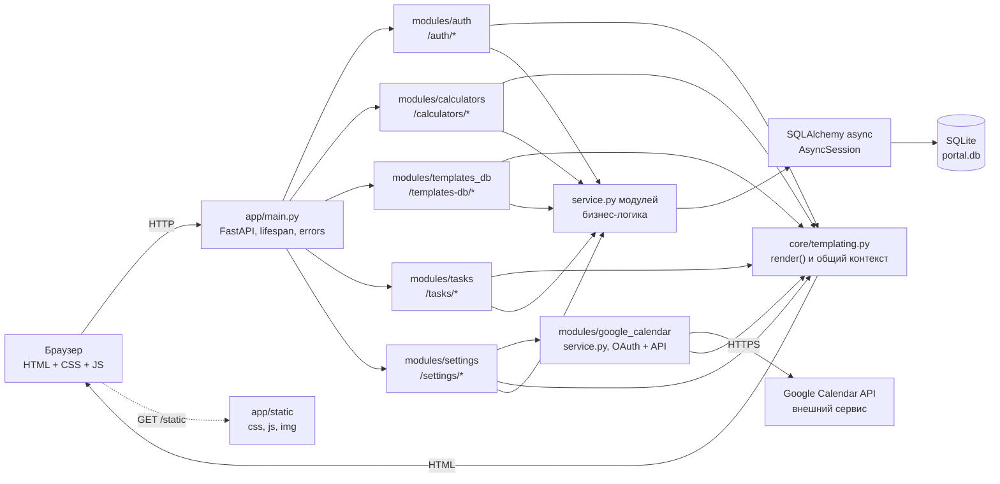
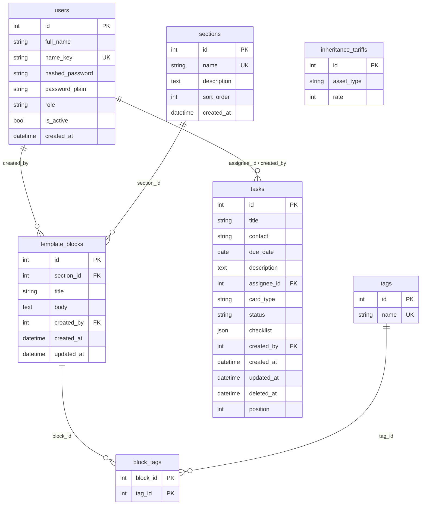

# Карта проекта

> Снимок на 24.10.2026, коммит `0104fde` (ветка `main`).
> Документ описывает фактическую структуру кода. Источник истины — код и
> `clinerules/`; при расхождении с `README.md` или `memory-bank/` ориентируйтесь
> на код.

## 1. Назначение и состав

Внутренний портал нотариальной конторы для локальной сети: серверный рендеринг
Jinja2, FastAPI и SQLite. Клиентского фреймворка и сборщика нет — интерактивность
обеспечивают обычные ES5-скрипты из `app/static/js/`.

| Параметр | Значение |
| --- | --- |
| Точка входа | `app/main.py` → `app.main:app` |
| Python | 3.11+ (в окружении 3.12) |
| Веб-сервер | Uvicorn, обычно `http://127.0.0.1:8000` |
| ORM | SQLAlchemy 2.0 async + `aiosqlite` |
| БД | SQLite `portal.db` в корне (в `.gitignore`) |
| Шаблоны | Jinja2, `app/templates/` |
| Статика | `app/static/`, монтируется на `/static` без кэширования |
| Авторизация | bcrypt + JWT HS256 в httpOnly-cookie `portal_token` |
| Функциональные модули | `auth`, `calculators`, `templates_db`, `tasks`, `settings`, `google_calendar` |
| Клиентские скрипты | 14 файлов в `app/static/js/` |
| Jinja-шаблоны | 29 файлов в `app/templates/` (включая `base.html` и эталон `_block_template.html`) |
| Внешние интеграции | Google Календарь (OAuth-клиент + Calendar API), настройка — `SetupCal.md` |

## 2. Слои и направление зависимостей



Ключевые правила:

- Роутеры подключаются только в `app/main.py`; префиксы задаются там же:
  `auth` — `/auth`, `calculators` — `/calculators`, `tasks` — `/tasks`,
  `templates_db` — `/templates-db`.
- Все страницы рендерятся через `render()` из `app/core/templating.py`, который
  добавляет `user`, `initials`, `role_label`, `role_labels`, `active_menu`.
- Модели импортируются в `app/main.py` до `Base.metadata.create_all`, иначе
  SQLAlchemy не создаст их таблицы.
- `calculators` не имеет моделей и не пишет в БД: расчёты либо клиентские, либо
  выполняются чистой функцией в `service.py`.
- `templates_db` работает с БД через собственный `service.py`; его `models.py`
  не импортирует `auth.models`, а ссылается на таблицу `users` строкой.

## 3. Структура каталогов

```text
Portal/
├── app/
│   ├── main.py                  сборка FastAPI, статика, роутеры, /dashboard
│   ├── core/
│   │   ├── config.py            Settings из .env (pydantic-settings)
│   │   ├── database.py          async engine, sessionmaker, get_db()
│   │   ├── security.py          bcrypt, JWT, cookie portal_token
│   │   └── templating.py        render(), initials(), ROLE_LABELS, MENU_PANEL/USERS/PROFILE
│   ├── db/
│   │   └── base.py              единый DeclarativeBase
│   ├── modules/
│   │   ├── auth/                пользователи, вход, роли, профиль
│   │   ├── calculators/         каталог и страницы калькуляторов
│   │   ├── google_calendar/     OAuth-клиент, токен, события Google Календаря
│   │   ├── settings/            справочники и разделы настроек
│   │   ├── tasks/               раздел «Задачи»: карточки канбан-доски
│   │   └── templates_db/        база заготовок: разделы, теги, блоки
│   ├── templates/
│   │   ├── base.html            общий каркас, шапка, меню, блок scripts
│   │   ├── _macros.html         иконки и строки статуса
│   │   ├── _users_panel.html    раздел «Пользователи» внутри настроек
│   │   ├── _inheritance_tariff_panel.html   региональный тариф наследства
│   │   ├── _google_calendar_panel.html      связь с Google Календарём
│   │   ├── auth/                login.html, profile.html
│   │   ├── dashboard/           index.html
│   │   ├── calculators/         index + 9 страниц + _block_template.html
│   │   ├── settings/            index.html, section.html
│   │   ├── tasks/               index.html — доска с окнами создания и правки,
│   │   │                        trash.html — корзина, form.html — карточка,
│   │   │                        _form_fields_main.html / _form_fields_extra.html
│   │   │                        — общие части полей
│   │   └── templates_db/        index, section_form, block_form, block_view
│   └── static/
│       ├── css/styles.css       рабочая копия дизайн-кода
│       ├── img/logo.jpg
│       └── js/                  14 клиентских скриптов
├── clinerules/
│   ├── 01-carcass.md            стек, структура, запреты
│   └── 02-calculators.md        правила и эталоны калькуляторов
├── memory-bank/                 справочник состояния проекта
├── scripts/create_admin.py      создание администратора
├── styles.css                   утверждённый дизайн-код (корневая копия)
├── alembic.ini                  конфиг Alembic, миграции не используются
├── requirements.txt             зафиксированные зависимости
├── run.bat                      запуск: venv, зависимости, .env, админ, сервер
├── README.md                    вход, роли, запуск, переменные окружения
├── SetupCal.md                  инструкция подключения Google Календаря
├── config/google_calendar/      ключ OAuth-клиента и токен (не в git)
├── .env.example                 шаблон настроек
├── portal.db                    локальная SQLite (не в git)
├── uvicorn.log                  лог запуска (игнорируется)
└── uvicorn.err                  баннер запуска (игнорируется)
```

`venv/`, `__pycache__/`, `.env`, `*.db` и `*.log` исключены через `.gitignore`.

## 4. Функциональные модули

### 4.1. `app/modules/auth` — вход и пользователи

| Файл | Назначение |
| --- | --- |
| `models.py` | модель `User` (таблица `users`) |
| `schemas.py` | `LoginForm`, `UserCreate`, `AdminUserUpdate`, `PasswordChange`, `name_key()` |
| `service.py` | поиск, создание, переименование, смена пароля, удаление, аутентификация |
| `dependencies.py` | `CurrentUser`, `OptionalUser`, `require_role()` |
| `routes.py` | `APIRouter(prefix="/auth")`: вход, выход, пользователи, профиль |

Модель `User`:

- `id` — первичный ключ;
- `full_name` — ФИО, оно же логин (только русские буквы, пробел и дефис);
- `name_key` — нормализованное имя без учёта регистра, уникально;
- `hashed_password` — bcrypt-хеш;
- `password_plain` — пароль в открытом виде для просмотра администратором;
- `role` — `admin` («Нотариус») или `user` («Сотрудник»);
- `is_active` — активность учётной записи;
- `created_at` — дата создания.

Механика доступа:

1. `POST /auth/login` проверяет имя и пароль через `authenticate_user()`.
2. При успехе `create_access_token(subject=str(user.id), role=user.role)`
   подписывает JWT HS256.
3. Токен кладётся в httpOnly-cookie `portal_token` (`SameSite=Lax`, срок
   `ACCESS_TOKEN_EXPIRE_MINUTES`, по умолчанию 480 минут).
4. `get_current_user()` декодирует токен, читает пользователя по `id` и
   проверяет `is_active`; в токене нет имени, поэтому переименование не рвёт
   сессию.
5. `require_role("admin")` ограничивает раздел «Пользователи».
6. Неавторизованный запрос (`401`) перенаправляется на `/auth/login`, запрос без
   прав (`403`) — на `/dashboard?denied=1`.

### 4.2. `app/modules/calculators` — калькуляторы

| Файл | Назначение |
| --- | --- |
| `routes.py` | каталог, страницы калькуляторов, серверный расчёт госпошлины |
| `schemas.py` | валидация госпошлины и справочники подписей `*_LABELS` |
| `service.py` | `CALCULATOR_BLOCKS`, тарифы, `calculate_gosposhlina()`, `format_money()` |

Моделей БД у модуля нет. Каталог карточек задаётся кортежем `CALCULATOR_BLOCKS`
в `service.py` (блоки разделены линиями на странице списка); чтобы добавить
калькулятор, нужно добавить карточку в нужный блок, роут, шаблон и (для
клиентского расчёта) JS-файл.

Страницы раздела:

| Калькулятор | Где считается | Ключевая логика |
| --- | --- | --- |
| Расчет и сдача | браузер | `raschet-i-sdacha.js`, пятнадцать сумм и поле «Итого» |
| Купля-продажа, обязательная форма | браузер | `calculators.js`, тариф 0,5 %, минимум 300 ₽, максимум 20 000 ₽ |
| Удостоверение ДКП, необязательная форма | браузер | `udostoverenie-dkp.js`, категории получателя |
| Удостоверение дарения недвижимости | браузер | `udostoverenie-dareniya.js`, категории получателя |
| Выделение долей по МСК | браузер | `vydelenie-doley-msk.js`, подбор доли, стоимость, нотариальный тариф и льгота |
| Госпошлина | сервер | `POST /calculators/gosposhlina` → `GosposhlinaInput` → `calculate_gosposhlina()` |

Клиентские калькуляторы:

- обновляют показатели при каждом `input`;
- перехватывают `submit` и не отправляют форму;
- хранят введённые значения в `localStorage`;
- форматируют суммы через `money-input.js`;
- не пишут данные на сервер.

Серверный калькулятор госпошлины:

- принимает форму с суммой, типом сделки и категорией плательщика;
- валидирует данные Pydantic-схемой;
- считает чистую функцию `calculate_gosposhlina()`;
- возвращает тот же шаблон с результатом или сообщением об ошибке.

### 4.3. `app/modules/templates_db` — база заготовок

| Файл | Назначение |
| --- | --- |
| `models.py` | `Section`, `Tag`, `TemplateBlock`, ассоциативная таблица `block_tags` |
| `schemas.py` | валидация разделов, заготовок, тегов, превью |
| `service.py` | CRUD, поиск, теги, преобразование ORM в схемы чтения |
| `routes.py` | `APIRouter(tags=["templates_db"])`: разделы, заготовки, поиск |

Модели:

- `Section` — раздел базы (`name` уникально, `description`, `sort_order`);
- `Tag` — тег в нижнем регистре (`name` уникально);
- `TemplateBlock` — заготовка (`section_id`, `title`, `body`, `created_by`,
  `created_at`, `updated_at`);
- `block_tags` — связь многие ко многим между заготовками и тегами с
  каскадным удалением связей.

Особенности:

- автор хранится как `users.id`; `models.py` не импортирует `auth.models`
  (в роутах `User` используется только для аннотаций);
- связь автора загружается жадно (`lazy="joined"`), потому что ленивая
  загрузка в async-сессии запрещена;
- новые теги создаются автоматически при сохранении заготовки;
- удалить непустой раздел нельзя — `SectionNotEmptyError`;
- после успешных действий выполняется `303 RedirectResponse` с флагом
  `?saved=1`, `?created=1`, `?updated=1` или `?deleted=1`.

### 4.4. `app/modules/settings` — справочники и разделы настроек

| Файл | Назначение |
| --- | --- |
| `models.py` | `InheritanceTariff` (таблица `inheritance_tariffs`: `asset_type`, `rate`) |
| `schemas.py` | `InheritanceTariffInput`: вид имущества до 200 символов, тариф — целое больше нуля |
| `service.py` | список, чтение, создание, правка и удаление строк справочника |
| `routes.py` | `APIRouter(tags=["settings"])`: пользователи, резервное копирование, тариф, Google Календарь |

Особенности:

- доступ ко всем маршрутам закрыт `require_role("admin")` (`AdminUser`);
- страница `settings/index.html` — общее меню разделов слева (`?section`), справа
  подключается партиал `_users_panel.html`, `_inheritance_tariff_panel.html` или
  `_google_calendar_panel.html`;
- `_render_settings()` и `_render_tariffs_section()` собирают контекст страницы,
  ошибки валидации возвращаются с кодом `400` без редиректа;
- успешные действия завершаются `303` с флагом `?created=1`, `?updated=1`,
  `?deleted=1`, `?uploaded=1`, `?disconnected=1`;
- `/settings/backup` — по-прежнему заглушка `settings/section.html`.

### 4.5. `app/modules/google_calendar` — связь с Google Календарём

| Файл | Назначение |
| --- | --- |
| `service.py` | состояние связи, загрузка ключа, вход в Google, проверка токена, тестовое событие |
| `__init__.py` | пустой: модуль используется как `from app.modules.google_calendar import service` |

Ключевые константы `service.py`:

| Константа | Значение | Смысл |
| --- | --- | --- |
| `CONFIG_DIR` | `config/google_calendar` | каталог ключа и токена (в `.gitignore`) |
| `CREDENTIALS_PATH` | `.../credentials.json` | ключ OAuth-клиента, загруженный нотариусом |
| `TOKEN_PATH` | `.../token.json` | токен доступа, полученный после входа |
| `ACCOUNT_PATH` | `.../account.txt` | почта подключённого аккаунта |
| `SCOPES` | `https://www.googleapis.com/auth/calendar` | полный доступ к календарю |
| `MAX_CREDENTIALS_SIZE` | 64 КБ | предел размера загружаемого файла ключа |
| `CONNECT_TIMEOUT_SECONDS` | 300 | ожидание кода подтверждения от Google |
| `LOOPBACK_HOSTS` | `localhost`, `127.0.0.1`, `::1` | вход разрешён только на самом сервере |
| `DEFAULT_EVENT_TIME` | `09:00` | время события из карточки, если поле времени пустое |
| `EVENT_DURATION_MINUTES` | 60 | длительность события, созданного из карточки |

Публичные функции: `get_status()` → `GoogleCalendarStatus` (`libraries_installed`,
`has_credentials`, `has_token`, `connected`, `account`, `message`),
`save_credentials()`, `delete_credentials()`, `disconnect()`, `start_connect()`,
`connect_state()`, `create_test_event()`, `create_task_event()`, `last_test_event()`,
`is_connected()`, `is_loopback_host()`, `libraries_available()`.

Как работает:

1. Нотариус загружает JSON OAuth-клиента типа **Desktop app**; файл проверяется
   по размеру и содержимому (`installed`/`web`, `client_id`) и кладётся в
   `config/google_calendar/credentials.json`.
2. `start_connect()` поднимает фоновый поток: `InstalledAppFlow.run_local_server()`
   слушает loopback-порт, поэтому вход выполняется только на компьютере с
   порталом. Состояние опрашивает `google-calendar.js` через
   `/settings/google-calendar/connect/status`.
3. Полученный токен сохраняется в `token.json`; при истечении он обновляется по
   refresh-токену без участия пользователя.
4. `create_test_event()` создаёт событие «Проверка связи с Google Календарём» на
   завтра, 10:00, в часовом поясе сервера и возвращает ссылку на событие.
5. `create_task_event(title, due_date, start_time)` создаёт событие из карточки
   задачи: заголовок — «Заголовок карточки», дата — «Срок», время — поле
   `GoogCalTime` (пустое или некорректное — `DEFAULT_EVENT_TIME`), длительность —
   `EVENT_DURATION_MINUTES`. Вызывается из `tasks.routes.task_create` через
   `run_in_threadpool`, уже после сохранения карточки.
6. Ошибки входа переводятся в понятный текст функциями `_connect_error_message()`
   и `_connect_error_hint()` (тестовые пользователи, статус Testing, доступ к
   scope, `redirect_uri_mismatch`).

## 5. Маршруты

Обозначения доступа: **все** — без авторизации, **авторизован** — любой активный
сотрудник, **admin** — только роль `admin`.

### 5.1. Корень и панель (`app/main.py`)

| Метод | Путь | Доступ | Обработчик | Результат |
| --- | --- | --- | --- | --- |
| GET | `/` | все | `root` | `303` на `/dashboard` |
| GET | `/dashboard` | авторизован | `dashboard` | `dashboard/index.html`; `?denied=1` — пояснение об отказе |

Обработчики ошибок: `401` → `/auth/login`, `403` → `/dashboard?denied=1`.

### 5.2. Аутентификация (`app/modules/auth/routes.py`)

| Метод | Путь | Доступ | Обработчик | Результат |
| --- | --- | --- | --- | --- |
| GET | `/auth/login` | все | `login_form` | `auth/login.html`; уже вошедшего ведёт на `/dashboard` |
| POST | `/auth/login` | все | `login` | проверка пароля, cookie `portal_token`, `303` на `/dashboard` |
| POST | `/auth/logout` | авторизован | `logout` | удаление cookie, `303` на `/auth/login` |
| GET | `/auth/profile` | авторизован | `profile_page` | `auth/profile.html` |
| POST | `/auth/profile/password` | авторизован | `profile_password_change` | смена своего пароля, `303` на `?updated=1` |
| POST | `/auth/profile/marker-color` | авторизован | `profile_marker_color_change` | смена цвета своей метки, `303` на `?color=1` |

### 5.3. Калькуляторы (`app/modules/calculators/routes.py`)

| Метод | Путь | Доступ | Обработчик | Шаблон / результат |
| --- | --- | --- | --- | --- |
| GET | `/calculators/` | авторизован | `index_page` | `calculators/index.html` |
| GET | `/calculators/raschet-i-sdacha` | авторизован | `raschet_i_sdacha_page` | `calculators/raschet_i_sdacha.html` |
| GET | `/calculators/kuplya-prodazha` | авторизован | `kuplya_prodazha_page` | `calculators/kuplya_prodazha.html` |
| GET | `/calculators/udostoverenie-dkp` | авторизован | `udostoverenie_dkp_page` | `calculators/udostoverenie_dkp.html` |
| GET | `/calculators/udostoverenie-dareniya` | авторизован | `udostoverenie_dareniya_page` | `calculators/udostoverenie_dareniya.html` |
| GET | `/calculators/vydelenie-doley-msk` | авторизован | `vydelenie_doley_msk_page` | `calculators/vydelenie_doley_msk.html` |
| GET | `/calculators/gosposhlina` | авторизован | `gosposhlina_page` | `calculators/gosposhlina.html` |
| POST | `/calculators/gosposhlina` | авторизован | `gosposhlina_calculate` | тот же шаблон с результатом или ошибкой (400) |

### 5.4. База заготовок (`app/modules/templates_db/routes.py`)

| Метод | Путь | Доступ | Обработчик | Шаблон / результат |
| --- | --- | --- | --- | --- |
| GET | `/templates-db/` | авторизован | `index_page` | `templates_db/index.html` |
| GET | `/templates-db/search` | авторизован | `search_page` | `templates_db/index.html` с фильтрами `section_id`, `tag`, `q` |
| GET | `/templates-db/sections/new` | авторизован | `section_new_form` | `templates_db/section_form.html` |
| POST | `/templates-db/sections/new` | авторизован | `section_new` | создание раздела, `303` на `?saved=1` |
| GET | `/templates-db/sections/{section_id}/edit` | авторизован | `section_edit_form` | `templates_db/section_form.html` |
| POST | `/templates-db/sections/{section_id}/edit` | авторизован | `section_edit` | сохранение, `303` на `?saved=1` |
| POST | `/templates-db/sections/{section_id}/delete` | авторизован | `section_delete` | удаление пустого раздела, `303` на `?deleted=1` |
| GET | `/templates-db/blocks/new` | авторизован | `block_new_form` | `templates_db/block_form.html`; нужен хотя бы один раздел |
| POST | `/templates-db/blocks/new` | авторизован | `block_new` | создание заготовки, `303` на `?saved=1` |
| GET | `/templates-db/blocks/{block_id}` | авторизован | `block_view` | `templates_db/block_view.html` |
| GET | `/templates-db/blocks/{block_id}/edit` | авторизован | `block_edit_form` | `templates_db/block_form.html` |
| POST | `/templates-db/blocks/{block_id}/edit` | авторизован | `block_edit` | сохранение, `303` на `?saved=1` |
| POST | `/templates-db/blocks/{block_id}/delete` | авторизован | `block_delete` | удаление, `303` на `?deleted=1` |

### 5.5. Настройки (`app/modules/settings/routes.py`)

| Метод | Путь | Доступ | Обработчик | Шаблон / результат |
| --- | --- | --- | --- | --- |
| GET | `/settings` | admin | `settings_page` | `settings/index.html` — меню разделов настроек |
| GET | `/settings/users` | admin | `settings_users_page` | `settings/index.html` + `_users_panel.html`; `?edit=<id>` — форма правки |
| POST | `/settings/users` | admin | `settings_users_create` | создание сотрудника, `303` на `?created=1` |
| POST | `/settings/users/{user_id}/update` | admin | `settings_users_update` | смена имени и пароля, `303` на `?updated=1` |
| POST | `/settings/users/{user_id}/delete` | admin | `settings_users_delete` | удаление, кроме себя, `303` на `?deleted=1` |
| GET | `/settings/backup` | admin | `settings_backup_page` | `settings/section.html` — заглушка |
| GET | `/settings/inheritance-tariff` | admin | `settings_inheritance_tariff_page` | `settings/index.html` + `_inheritance_tariff_panel.html`; `?edit=<id>` — форма правки |
| POST | `/settings/inheritance-tariff` | admin | `settings_inheritance_tariff_create` | добавление строки, `303` на `?created=1` |
| POST | `/settings/inheritance-tariff/{tariff_id}/update` | admin | `settings_inheritance_tariff_update` | правка строки, `303` на `?updated=1` |
| POST | `/settings/inheritance-tariff/{tariff_id}/delete` | admin | `settings_inheritance_tariff_delete` | удаление строки, `303` на `?deleted=1` |
| GET | `/settings/google-calendar` | admin | `settings_google_calendar_page` | `_google_calendar_panel.html`; флаги `?uploaded=`, `?deleted=`, `?disconnected=` |
| POST | `/settings/google-calendar/credentials` | admin | `settings_google_calendar_upload_credentials` | приём файла ключа (multipart), `303` на `?uploaded=1` или `400` с текстом ошибки |
| POST | `/settings/google-calendar/credentials/delete` | admin | `settings_google_calendar_delete_credentials` | удаление ключа вместе с токеном, `303` на `?deleted=1` |
| POST | `/settings/google-calendar/connect` | admin | `settings_google_calendar_connect` | вход в Google на loopback-адресе; с другого хоста — `400` с подсказкой |
| GET | `/settings/google-calendar/connect/status` | admin | `settings_google_calendar_connect_status` | `JSONResponse` — состояние фонового входа |
| POST | `/settings/google-calendar/disconnect` | admin | `settings_google_calendar_disconnect` | забыть токен, ключ остаётся, `303` на `?disconnected=1` |
| POST | `/settings/google-calendar/test-event` | admin | `settings_google_calendar_test_event` | создание тестового события; при ошибке `400` с текстом |

### 5.6. Задачи (`app/modules/tasks/routes.py`)

| Метод | Путь | Доступ | Обработчик | Шаблон / результат |
| --- | --- | --- | --- | --- |
| GET | `/tasks/` | авторизован | `index_page` | `tasks/index.html` — доска, фильтры `?assignee=` (карточки сотрудника и без исполнителя; без параметра — текущий сотрудник), `?q=` |
| GET | `/tasks/trash` | авторизован | `trash_page` | `tasks/trash.html` — корзина, флаги `?restored=`, `?purged=` |
| GET | `/tasks/create` | авторизован | `task_create_form` | `tasks/form.html` — новая карточка (`?card_type=`) |
| POST | `/tasks/create` | авторизован | `task_create` | создание в конец «На очереди», `303` на `?saved=1`; с отметкой Google — `&gcal=created`/`no_date`/`failed` |
| GET | `/tasks/update/{task_id}` | авторизован | `task_edit_form` | `tasks/form.html` с текущими значениями; нет карточки — доска `404` |
| POST | `/tasks/update/{task_id}` | авторизован | `task_update` | сохранение полей (столбец не меняется), `303` на `?saved=1` |
| POST | `/tasks/delete/{task_id}` | авторизован | `task_delete` | в корзину (`deleted_at`), `303` на `?deleted=1` |
| POST | `/tasks/restore/{task_id}` | авторизован | `task_restore` | из корзины в конец столбца, `303` на `/tasks/trash?restored=1` |
| POST | `/tasks/purge/{task_id}` | авторизован | `task_purge` | окончательное удаление только из корзины (иначе `400`), `303` на `/tasks/trash?purged=1` |
| POST | `/tasks/move/{task_id}` | авторизован | `task_move` | JSON `{status, position}` → `TaskMoveResult` (`ok`, `assignee_id`, `assignee_name`, `assignee_color`); перенос из «На очереди» подставляет авторизованного сотрудника, только если исполнитель не указан; нет карточки — `404` |

Доска и корзина собираются сервисом (`list_board`, `group_by_status`,
`list_trash`, `count_trash`), список сотрудников для фильтра и поля
«Выполняет» отдаёт `auth.service.list_users`. Модели auth модуль не
импортирует. Чек-лист приходит повторяющимся полем `checklist`
(`{пункт: True}`), пункты чужого типа отбрасывает схема `TaskCreate`.

Типы карточек и их чек-листы заданы в `app/modules/tasks/schemas.py`:
`CARD_TYPE_LABELS` (порядок словаря = порядок пунктов списка «Тип карточки»)
и `CARD_TYPE_CHECKLISTS` (порядок пунктов = порядок чекбоксов), ключи обоих
словарей совпадают со значениями `TaskCardType`. Список типов: «Договор
дарения» (`gift`), «Договор купли-продажи с несовершеннолетним» (`sale_minor`),
«Договор купли-продажи (иное)» (`sale_other`), «Наследство» (`inheritance`),
«Доверенность» (`power_of_attorney`), «Согласие супруга» (`spouse_consent`),
«Иное» (`other`), «Личное» (`personal`). У `sale_minor` (10 пунктов) и `sale_other`
(8 пунктов) набор заканчивается пунктом «Справка о составе семьи»; у
`power_of_attorney` — четыре пункта: «Документы доверителя», «Данные
поверенного», «Содержание доверенности», «Родственные отношения». Опции
списка и первичный набор чекбоксов выводит шаблон, дальше чекбоксы
перерисовывает `js/tasks.js` по словарю `data-task-checklists`; в JavaScript
перечня пунктов нет.

Фильтр «Исполнитель» (`?assignee=<id>`) в `list_board` отбирает карточки
выбранного сотрудника вместе с карточками без исполнителя
(`assignee_id IS NULL`): «ничьи» карточки видны в списке любого сотрудника.
Пункт «Все сотрудники» (пустой `?assignee=`) показывает всю доску. Кнопка
**«Обновить»** отправляет GET-форму; `js/tasks.js` делает то же самое сам —
при смене исполнителя сразу, при поиске по Enter и выходе из поля.

При входе в раздел `index_page` подставляет в фильтр авторизованного
сотрудника: адрес `/tasks/` без параметров (пункт меню, «Отмена» в форме,
«Назад к доске» из корзины) показывает карточки текущего сотрудника и
«ничьи». Отличить вход в раздел от осознанного выбора помогает пустой
параметр: `?assignee=` — это «Все сотрудники». Кнопка **«Сброс»** ведёт на
`/tasks/`: поле «Поиск» очищается, а в «Исполнителе» снова текущий
сотрудник; чтобы посмотреть всю доску, в списке выбирают «Все сотрудники»
(или открывают `/tasks/?assignee=`). Переходы после действий (`?saved=`,
`?deleted=`, `?gcal=`) и поиск `?q=` подстановку не делают — на доске
остаётся то, что записано в адресе, и только что созданная карточка
с другим исполнителем не пропадает из вида.

Поля карточки вынесены в две общие части: `tasks/_form_fields_main.html`
(тип, заголовок, контакт, срок, «Выполняет») и `tasks/_form_fields_extra.html`
(описание, чек-лист). Их подключают и `tasks/form.html` (одной колонкой),
и оба модальных окна доски — поэтому набор и порядок полей задан один раз.
Партиалы принимают необязательную переменную `field_prefix`: окно правки
передаёт `edit-`, чтобы `id` полей не совпадали с окном создания (у чек-листа
своего `id` нет — `js/tasks.js` находит контейнер внутри формы).

В окнах поля разложены по двум колонкам (`.modal--task`): в левой части —
основные поля и кнопки, в правой — описание и чек-лист. Окно создания
(`#task-modal`) отправляет форму на `/tasks/create`, кнопки — «Добавить
карточку» и «Отмена». Окно правки (`#task-edit-modal`) отправляет её
на `/tasks/update/{id}`, кнопки — «Сохранить изменения», «Отмена»,
«Удалить карточку» (`btn--danger`). Окно правки на доске одно на все
карточки и открывается щелчком по самой карточке: `<article>` несёт
`data-task-edit`, `data-task-form` (адрес сохранения), `data-task-delete-url`
и `data-task` (JSON с заголовком, типом, контактом, сроком, исполнителем,
описанием и чек-листом), а также `role="button"`, `tabindex="0"`
и `aria-haspopup="dialog"` — карточка открывается и с клавиатуры (Enter или
пробел). Кнопок «Редактировать» и «Удалить» на карточке нет: удаление идёт
из окна правки или со страницы `/tasks/update/{id}` (там кнопка «Удалить
карточку» с `formaction="/tasks/delete/{id}"` и `formnovalidate`).
`js/tasks.js` переносит JSON в поля и открывает окно. Щелчок сразу после
перетаскивания окно не открывает (`dragEndedAt` и `CLICK_AFTER_DRAG = 250 мс`),
поэтому отпускание мыши после переноса щелчком не считается.
«Удалить карточку» спрашивает подтверждение в том же окне, что и формы
с `data-confirm`, и отправляет форму на адрес удаления (`303` на `?deleted=1`);
обработчик `submit` берёт подтверждение и адрес у нажатой кнопки
(`event.submitter`, `data-confirm` и `formaction`), поэтому одна и та же
кнопка работает и на странице правки, и в окне. Без JS щелчок окно
не открывает — в карточке лежит `<noscript>` с обычной ссылкой
на `/tasks/update/{id}` (при включённом JS браузер этот блок не создаёт).
Контекст доски дополняют `default_card_type` (тип
по умолчанию для окна создания — `sale_minor`, «Договор купли-продажи
с несовершеннолетним») и `deleted_at` в `TaskListItem` (дата удаления
в корзине). Для предзаполнения окна правки `TaskListItem` несёт ещё
`description` и `checklist` (словарь `{пункт: True}` по всему набору типа).

Поле «Срок» — строка `.field--due`: слева стоит само поле, справа — блок
«Добавить в Google календарь» (надпись в стиле подписи поля, под ней чекбокс
`GoogCal` и поле времени `GoogCalTime` без отдельных подписей); блок виден,
только если Google Календарь подключён и форма создаёт карточку: шаблоны
передают `gcal_enabled` (окно правки — `false`, остальные оставляют значение
по умолчанию `not task`), поэтому на странице правки и в окне правки блока
нет — события там не создаются. Ширину поля «Срок» и кнопки «Добавить
карточку» задаёт одна переменная `--task-action-width` (165px): у кнопки это
`min-width`, у поля — `width`, поэтому в модалке и на `/tasks/create` они
совпадают (на странице правки кнопка «Сохранить изменения» длиннее
и остаётся по содержимому). Флаг `google_calendar_connected` в контексте
доски и формы — это `google_calendar.is_connected()`: проверка наличия
`config/google_calendar/token.json` без обращения к сети. Поля `GoogCal`
(чекбокс) и `GoogCalTime` (время) читает только `task_create` — через
`Form(alias=...)`, потому что регистр имён в разметке: `GoogCal`/`GoogCalTime`.
В `TaskCreate`/`TaskUpdate` их нет, поэтому в данные карточки они не попадают.
Если отметка стоит, после сохранения карточки создаётся событие: заголовок —
«Заголовок карточки», дата — «Срок», время — `GoogCalTime`. Событие создаётся
в пуле потоков (`run_in_threadpool`, как в настройках), поэтому отказ Google
карточку не отменяет, а доска показывает итог по флагу `gcal`: `created` —
событие создано, `no_date` — у карточки не заполнен срок, `failed` — Google
или подключение вернули ошибку (подробности в журнале).

На карточке доски и в корзине показываются только заголовок и одна строка
с исполнителем: на доске — «Исполнитель | Срок: …», в корзине —
«Исполнитель | Удалена: …» (`.card__row`, разделитель `.card__bar`).
Контакт в карточке не выводится, хотя остаётся полем карточки в форме правки
и в окнах доски. Тип карточки и её номер из вывода убраны. Вместо них левая
грань карточки несёт метку исполнителя — полосу 3px со скруглением справа
(тот же приём, что у активного пункта меню). Цвет полосы — `marker_color`
сотрудника: сервис кладёт его в `TaskListItem.assignee_color`, шаблон
выводит inline-SVG `.card__marker` с `<rect fill="…">` (inline-стили
в шаблонах запрещены — так же выводится метка в `_users_panel.html`).
У карточки без исполнителя полосы нет.

Если карточку перетащили из «На очереди» в другой столбец и исполнитель
ещё не указан, им становится авторизованный сотрудник: `move_task` принимает
`actor_id` (кто перетаскивает) и при `old_status == DEFAULT_STATUS` и пустом
`assignee_id` записывает его. Уже выбранного исполнителя перенос не меняет —
ни при выходе из «На очереди», ни при перестановках между остальными
столбцами. Ответ `POST /tasks/move/{id}` — `TaskMoveResult`
с `assignee_id`/`assignee_name`/`assignee_color`, по нему `js/tasks.js`
обновляет имя в строке «Исполнитель | Срок» (`data-task-assignee`) и левую
цветную метку без перезагрузки доски.

Корзина живёт на отдельной странице `/tasks/trash` (`tasks/trash.html`):
ссылка «Корзина» стоит в шапке доски рядом со «Сбросом», внутри — возврат
(`/tasks/restore/{task_id}`) и окончательное удаление
(`/tasks/purge/{task_id}`). Раньше корзина была секцией на самой доске;
отдельная страница разгрузила шапку и убрала дублирование разметки карточек.

Столбцы доски прокручиваются независимо. `.board` ограничен высотой рабочей
области, у `.board__column` — `max-height: 100%` и `overflow: hidden`;
заголовок `.board__head` выведен из прокручиваемой части, а прокручивается
только `.board__cards` (`overflow-y: auto`, `overscroll-behavior: contain`).
Поэтому шапка столбца остаётся на месте, а прокрутка колесом внутри колонки
не уводит всю страницу.

Доска работает и без JS: «Новая карточка» ведёт на `/tasks/create`,
а карточки открываются на правку по ссылке из `<noscript>` (с включённым JS
этот блок не создаётся, и карточка работает как кнопка). `app/static/js/tasks.js`
добавляет перетаскивание между столбцами (HTML5 DnD → `POST /tasks/move/{id}`
с `{status, position}` → `TaskMoveResult`; ответ сразу обновляет имя
исполнителя в карточке и цветную метку, при ошибке — перезагрузка доски),
модальное окно создания, окно правки по щелчку на карточке (и по Enter/пробелу)
с предзаполнением из `data-task`, удаление карточки из окна правки через окно
подтверждения, перерисовку чек-листа при смене типа и своё окно подтверждения
для форм с `data-confirm`.
Наборы пунктов чек-листа скрипт берёт
из атрибута `data-task-checklists` контейнера `[data-task-checklist]`
(`checklists|tojson|forceescape`) — второй копии списка в JavaScript нет.

## 6. Связка «шаблон → JavaScript»

`base.html` подключает `app.js` на всех страницах. Остальные скрипты
подключаются в `` конкретной страницы.

| Шаблон | Скрипты |
| --- | --- |
| `base.html` | `app.js` (заготовка, логики пока нет) |
| `auth/login.html`, `auth/profile.html` | нет |
| `dashboard/index.html` | нет |
| `calculators/index.html` | нет |
| `calculators/raschet_i_sdacha.html` | `money-input.js`, `calc-core.js`, `raschet-i-sdacha.js` |
| `calculators/kuplya_prodazha.html` | `money-input.js`, `calc-core.js`, `calculators.js` |
| `calculators/udostoverenie_dkp.html` | `money-input.js`, `calc-core.js`, `udostoverenie-dkp.js` |
| `calculators/udostoverenie_dareniya.html` | `money-input.js`, `calc-core.js`, `udostoverenie-dareniya.js` |
| `calculators/vydelenie_doley_msk.html` | `money-input.js`, `calc-core.js`, `vydelenie-doley-msk.js` |
| `calculators/gosposhlina.html` | `money-input.js`; расчёт на сервере |
| `calculators/_block_template.html` | `money-input.js`, `calc-core.js`, `js/<slug>.js` — эталон, роутом не используется |
| `templates_db/index.html` | `templates_db.js` |
| `templates_db/section_form.html` | `templates_db.js` |
| `templates_db/block_form.html` | `templates_db.js` |
| `templates_db/block_view.html` | `templates_db.js` |
| `tasks/index.html` | `tasks.js` |
| `tasks/form.html` | `tasks.js` |
| `settings/index.html` | `google-calendar.js` — только когда открыт раздел «Связь с Google Календарём» |
| `_google_calendar_panel.html` | нет: партиал внутри `settings/index.html`, скрипт подключает страница |

Назначение клиентских файлов:

| Файл | Ответственность |
| --- | --- |
| `money-input.js` | форматирование сумм в полях `[data-money]` неразрывными пробелами |
| `calc-core.js` | общие помощники: localStorage, разбор чисел и долей, `formatMoney`, `render` |
| `raschet-i-sdacha.js` | сумма пятнадцати полей в «Итого», Enter — к следующему полю |
| `calculators.js` | тариф за удостоверение договора купли-продажи (обязательная форма) |
| `udostoverenie-dkp.js` | тариф за удостоверение ДКП (необязательная форма) |
| `udostoverenie-dareniya.js` | тариф за удостоверение договора дарения |
| `vydelenie-doley-msk.js` | подбор долей по МСК, стоимость доли и нотариальный тариф |
| `templates_db.js` | копирование текста, поиск по Tab, подтверждение удаления |
| `tasks.js` | доска «Задачи»: перетаскивание, окно правки по щелчку на карточке (и по Enter/пробелу), окно создания, удаление из окна правки, чек-лист по типу, подтверждение удаления |
| `google-calendar.js` | опрос `/settings/google-calendar/connect/status`, ожидание входа в Google, перезагрузка страницы после подключения |
| `app.js` | зарезервирован под общую логику портала |

Скрипты калькуляторов используют IIFE, `"use strict"`, ES5-совместимый
синтаксис и `localStorage`. Ключи хранения имеют префикс `calculators.*`,
поэтому данные разных калькуляторов не пересекаются. Общие помощники лежат
в `calc-core.js` и берутся из `window.CalcCore`; иконки и строки статуса —
макросы `app/templates/_macros.html` (`status_warn`, `status_done`, `icon_*`),
копии SVG в шаблонах не создаются.

## 7. Модель данных



Ограничения и поведение:

- `users.name_key` уникален: регистр и повторные пробелы не создают дублей.
- `sections.name` уникально; `sort_order` задаёт порядок разделов.
- `template_blocks.section_id` обязателен, `created_by` может быть пустым.
- `block_tags` — составной первичный ключ, при удалении блока или тега связи
  удаляются каскадно.
- `SectionNotEmptyError` не даёт удалить раздел, в котором есть заготовки.
- `inheritance_tariffs` — плоский справочник без связей: `asset_type` и `rate`;
  дубли контролируются только формой и соглашением администратора.
- `tasks.deleted_at` переводит карточку в корзину, `position` хранит порядок на
  доске; `checklist` — JSON-словарь пунктов.
- Схему создаёт `Base.metadata.create_all` при старте; Alembic-миграции не
  используются. Для существующей SQLite-базы колонки добавляются вручную.

## 8. Основные сценарии

### 8.1. Вход сотрудника

```text
GET /auth/login
  → login_form()
  → auth/login.html

POST /auth/login (full_name, password)
  → LoginForm (Pydantic)
  → authenticate_user() → bcrypt
  → create_access_token(subject=user.id, role=user.role)
  → Set-Cookie: portal_token (httpOnly, SameSite=Lax)
  → 303 /dashboard

Любой защищённый запрос
  → get_current_user()
  → decode_access_token() → get_user_by_id() → is_active
  → CurrentUser или 401
```

### 8.2. Клиентский расчёт калькулятора

```text
GET /calculators/<slug>
  → роут рендерит шаблон
  → base.html + money-input.js + <slug>.js
  → восстановление полей из localStorage
  → input → пересчёт → обновление .calc__out
  → «Очистить» → удаление ключей (кроме сохраняемых полей)
```

Сервер в расчёте не участвует, форма не отправляется. Ошибки ввода показываются
рядом с полем, пустые значения дают `0`, а не `NaN`.

### 8.3. Серверный расчёт госпошлины

```text
POST /calculators/gosposhlina
  → Form(amount, deal_type, payer_type)
  → GosposhlinaInput (валидация)
  → calculate_gosposhlina()
  → TARIFFS[(deal_type, payer_type)]
  → тот же шаблон с result / error
```

При ошибке валидации возвращается `400` и та же страница с текстом ошибки.

### 8.4. Работа с базой заготовок

```text
GET /templates-db/?section_id=&saved=&deleted=
  → list_sections() + list_blocks()
  → templates_db/index.html

POST /templates-db/blocks/new
  → TemplateBlockCreate (поля и теги)
  → create_block(..., created_by=user.id)
  → _get_or_create_tags()
  → 303 /templates-db/?saved=1
```

Поиск `GET /templates-db/search` фильтрует по разделу, тегу и подстроке в
заголовке/тексте. Просмотр блока — отдельная страница с кнопкой копирования.

### 8.5. Рендеринг страницы

```text
роут → render(request, "module/page.html", user=..., active_menu=...)
  → core/templating.py добавляет user, initials, role_label, role_labels,
    active_menu
  → Jinja2: base.html +  + 
  → HTMLResponse
```

`active_menu` управляет подсветкой пункта меню: `templates_db`, `calculators`,
`users`, `profile`, `panel`, `tasks`, `settings`.

### 8.6. Подключение Google Календаря

```text
Настройки → Связь с Google Календарём (admin, только на localhost)
  → загрузка client_secret.json Desktop-клиента (POST /settings/google-calendar/credentials)
    → проверка размера (64 КБ) и полей client_id/installed → config/google_calendar/credentials.json
  → «Подключить календарь» (POST .../connect) → фоновый поток run_local_server()
    → браузер сервера открывает вход Google → код на loopback-адресе
    → token.json + account.txt
  → страница опрашивает GET .../connect/status и перезагружается
  → «Проверить связь» (POST .../test-event) → событие на завтра 10:00
```

## 9. Где что менять

### Новый калькулятор

1. Добавить карточку в `CALCULATOR_BLOCKS` (`app/modules/calculators/service.py`)
   — в тот блок, где калькулятор должен стоять на странице списка.
2. Добавить `GET`-роут в `app/modules/calculators/routes.py`.
3. Создать шаблон в `app/templates/calculators/`.
4. Для клиентского расчёта создать `app/static/js/<slug>.js` и подключить его
   в `` вместе с `money-input.js`.
5. Для выпадающих списков добавить справочник `*_LABELS` в
   `app/modules/calculators/schemas.py` и передать его из роута.
6. Для серверного расчёта добавить схему ввода, функцию в `service.py` и
   `POST`-обработчик.
7. Проверить страницу и обновить эту карту и `memory-bank/`.

### Новый модуль

1. Создать `app/modules/<модуль>/` с `models.py`, `schemas.py`, `service.py`,
   `routes.py` (при необходимости `dependencies.py`).
2. Импортировать модели в `app/main.py` до `Base.metadata.create_all`
   (`# noqa: F401`).
3. Подключить роутер в `app/main.py` с нужным префиксом.
4. Добавить шаблоны в `app/templates/<модуль>/`.
5. При необходимости добавить пункт меню в `app/templates/base.html` и
   константу `MENU_*` в `core/templating.py` или роутере модуля.
6. Не добавлять новые зависимости без изменения правил проекта.

### Подключение внешнего сервиса (пример — Google Календарь)

1. Секреты (ключ OAuth-клиента, токен, почта аккаунта) держать в `config/`
   и в `.gitignore`, в шаблоны и логи их не выводить.
2. Состояние связи описывать неизменяемым `dataclass` и отдавать странице одним
   вызовом `get_status()`; исключения не должны ронять рендер.
3. Долгие операции (вход в Google) запускать в отдельном потоке и опрашивать
   состояние через `GET .../connect/status`.
4. Ошибки переводить в текст для нотариуса и подсказку «что проверить» —
   в `SetupCal.md` уже собран разбор типовых причин.
5. Инструкцию по настройке на стороне сервиса хранить в корне (`SetupCal.md`)
   и ссылаться на неё из `README.md`.

### Новая страница или пункт меню

- Страница: роут → `render()` → шаблон, наследующий `base.html`.
- Меню: форма/ссылка в `base.html` + сравнение `active_menu`.
- Доступ: `CurrentUser` для сотрудников, `AdminUser`/`require_role("admin")`
  для административных разделов.

### Стили

- Утверждённый дизайн-код — `styles.css` в корне.
- Рабочая копия, которую отдают шаблоны, — `app/static/css/styles.css`.
- Правила требуют править только рабочую копию; фактическая синхронизация
  `.calc__out` затронула обе копии (открытый вопрос в `memory-bank/`).
- Новые классы — БЭМ-подобные, токены цветов и шрифтов уже заданы в `:root`.

### Изменение схемы БД

- Таблицы создаются автоматически только при первом запуске; `create_all` не
  добавляет колонки в существующую таблицу.
- Для локальной SQLite колонку добавляют вручную через `ALTER TABLE`.
- Alembic установлен, но миграции не ведутся.
- После изменения модели обновить `schemas.py`, `service.py`, формы и шаблоны.

## 10. Запуск и проверка

### Запуск

```powershell
run.bat
# или
venv\Scripts\Activate.ps1
uvicorn app.main:app --host 0.0.0.0 --port 8000
```

Портал: <http://127.0.0.1:8000/auth/login>.

Первый администратор:

```powershell
python scripts/create_admin.py
python scripts/create_admin.py --name "Иванов Иван Иванович" --password "..."
```

### Проверки

Автотестов и `tests/` в проекте нет. Рабочие приёмы:

| Что проверяется | Команда / способ |
| --- | --- |
| Синтаксис JS | `node --check app/static/js/<файл>.js` |
| Синтаксис Python | `python -m py_compile <файл>` |
| Пробелы в diff | `git diff --check` |
| HTTP и наличие элементов | одноразовый Python-скрипт с cookie `portal_token` |
| Клиентский расчёт | Node + DOM-заглушка, загрузка реального JS |
| Вёрстка | headless Chrome, сравнение `getBoundingClientRect()` |
| Статика | `GET /static/...` → `200`, актуальное содержимое |

Для HTTP-проверок сервер должен быть запущен. Одноразовые скрипты и скриншоты
держат вне репозитория (например, в `%TEMP%`).

## 11. Технический долг и особенности

- **Нет автотестов**: проверки выполняются одноразовыми скриптами.
- **Alembic не используется**: `alembic.ini` есть, миграций нет; схема
  создаётся через `create_all`.
- **Диагностические файлы выведены из git**: `app/static/_probe.html` и
  `uvicorn.err` не относятся к порталу и убраны из индекса (`936e469`);
  `*.err` теперь в `.gitignore`, файлы остаются на диске.
- **Две копии стилей**: корневой `styles.css` и
  `app/static/css/styles.css`; нужно следить за расхождениями.
- **Устаревшие части README**: структура и некоторые примечания отстают от
  кода; источник истины — код и `clinerules/`.
- **Пароль в открытом виде**: `password_plain` хранится намеренно, чтобы
  администратор мог выдать сотруднику пароль; это осознанный компромисс.
- **Дублирование справочников**: ключи `*_LABELS` в Python должны совпадать с
  ключами в JS-калькуляторах.
- **Клиентский расчёт не сохраняется на сервере**: данные живут только в
  `localStorage` браузера.
- **Google Календарь в режиме Testing**: пока приложение Google Cloud не переведено
  в `In production` (или не используется Internal-тип для Workspace), refresh-токен
  живёт около 7 дней — раз в неделю нужно повторять вход. Разбор — `SetupCal.md`,
  раздел 6.
- **Вход в Google только с сервера портала**: код подтверждения Google принимает
  лишь на loopback-адресе, поэтому кнопка «Подключить календарь» работает на
  `localhost`/`127.0.0.1`; сотрудники с других компьютеров видят статус и события,
  но не могут переподключить аккаунт.
- **Ключ и токен Google вне git**: `config/google_calendar/` в `.gitignore`; при
  переносе портала папку копируют вручную, иначе связь настраивается заново.
- **SQLite**: один локальный файл `portal.db`, резервная копия делается
  копированием файла при остановленном сервере.

## 12. Поддержание карты

Карту нужно обновлять при:

- добавлении или удалении модуля, роута, шаблона или JS-файла;
- изменении модели данных или схемы БД;
- изменении способа расчёта калькулятора;
- изменении меню, ролей или правил доступа;
- изменении команд запуска и проверки.

При расхождении карты и кода приоритет у кода. После правок проверяйте ссылки,
Mermaid-блоки и таблицы, затем выполняйте `git diff --check`.
