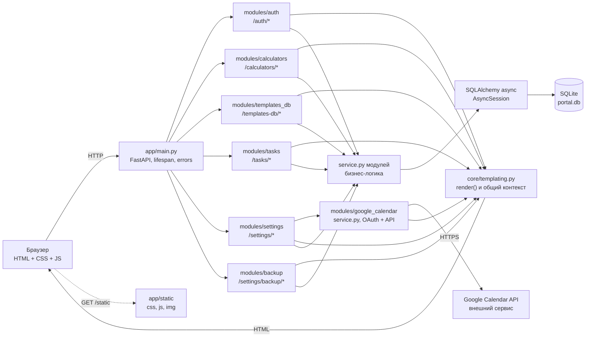
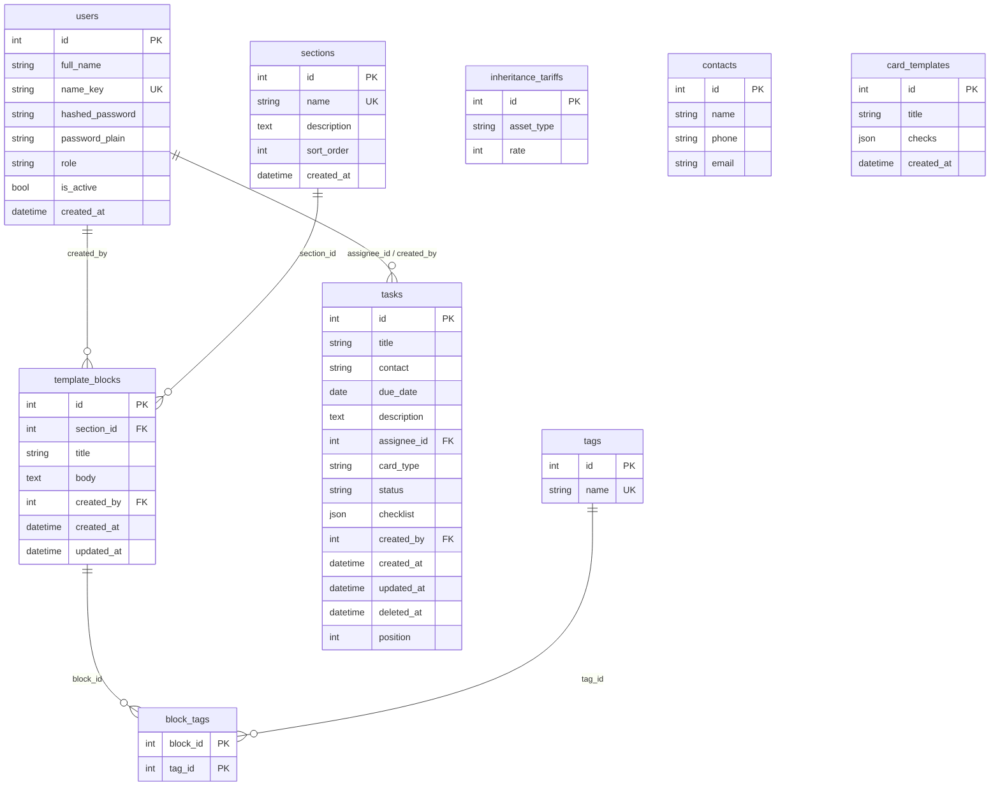

# Карта проекта

> Снимок на 28.10.2026, коммит `a37b0f5` (ветка `main`). В него вошли правки
> 28.10.2026 — значок срока у метки «Задачи» и новая раскладка пункта меню
> (счётчик сразу за словом, значок у правого края).
> Документ описывает фактическую структуру кода. Источник истины — код и
> `clinerules/`; при расхождении с `README.md` или `memory-bank/` ориентируйтесь
> на код.

## 1. Назначение и состав

Внутренний портал нотариальной конторы для локальной сети: серверный рендеринг
Jinja2, FastAPI и SQLite. Клиентского фреймворка и сборщика нет — интерактивность
обеспечивают обычные ES5-скрипты из `app/static/js/`.

| Параметр | Значение |
| --- | --- |
| Точка входа | `app/main.py` → `app.main:app` |
| Python | 3.11+ (в окружении 3.12) |
| Веб-сервер | Uvicorn, обычно `http://127.0.0.1:8000` |
| ORM | SQLAlchemy 2.0 async + `aiosqlite` |
| БД | SQLite `portal.db` в корне (в `.gitignore`) |
| Шаблоны | Jinja2, `app/templates/` |
| Статика | `app/static/`, монтируется на `/static` без кэширования |
| Авторизация | bcrypt + JWT HS256 в httpOnly-cookie `portal_token` |
| Функциональные модули | `auth`, `calculators`, `templates_db`, `tasks`, `settings`, `google_calendar` |
| Клиентские скрипты | 14 файлов в `app/static/js/` |
| Jinja-шаблоны | 33 файла в `app/templates/` (включая `base.html` и эталон `_block_template.html`) |
| Внешние интеграции | Google Календарь (OAuth-клиент + Calendar API), настройка — `SetupCal.md` |

## 2. Слои и направление зависимостей



Ключевые правила:

- Роутеры подключаются только в `app/main.py`; префиксы задаются там же:
  `auth` — `/auth`, `calculators` — `/calculators`, `tasks` — `/tasks`,
  `templates_db` — `/templates-db`. У `settings` и `backup` пути прописаны
  целиком (`/settings/...`), поэтому они подключаются без префикса.
- Разделы резервной копии регистрируются в реестре `modules/backup/registry.py`:
  ядро бэкапа не знает ни одной таблицы. Новый модуль добавляет
  `app/modules/<модуль>/backup.py` с `register(BackupSection(...))` и один
  импорт в `main.py` — `service.py` при этом не правится.
- Все страницы рендерятся через `render()` из `app/core/templating.py`, который
  добавляет `user`, `initials`, `role_label`, `role_labels`, `active_menu`,
  `tasks_badge`. Фрагменты для JavaScript (например, порция карточек
  «Базы данных») рендерит `render_partial()` из того же файла — без шапки,
  меню и общего контекста.
- Метку «Задачи» в меню (числа «ничьи | мои в работе» и число срочных карточек
  сотрудника) считает HTTP-middleware `tasks_menu_badge` в `app/main.py`: кладёт
  `request.state.tasks_badge`, `render()` переносит его в шаблон.
- Модели импортируются в `app/main.py` до `Base.metadata.create_all`, иначе
  SQLAlchemy не создаст их таблицы.
- Индексы, добавленные в модели позже, досоздаёт `_ensure_indexes()`
  в `app/main.py` (`index.create(checkfirst=True)` по всем таблицам метаданных):
  `create_all` пропускает уже существующую таблицу целиком, вместе с её новыми
  индексами. Запуск повторяем — готовые индексы пропускаются, схема не меняется.
- Ответы сжимает `GZipMiddleware` (`minimum_size=1024`, `compresslevel=6`) —
  он добавлен последним и потому оказывается внешним слоем, поэтому сжимает
  в том числе `/static`. Мелкие ответы, которые приходят чанками (числа метки
  «Задачи» на `/tasks/state`), сжимаются в любом случае.
- `calculators` не имеет моделей и не пишет в БД: расчёты либо клиентские, либо
  выполняются чистой функцией в `service.py`.
- `templates_db` работает с БД через собственный `service.py`; его `models.py`
  не импортирует `auth.models`, а ссылается на таблицу `users` строкой.

## 3. Структура каталогов

```text
Portal/
├── app/
│   ├── main.py                  сборка FastAPI, статика, роутеры, /dashboard, метка меню
│   ├── core/
│   │   ├── config.py            Settings из .env (pydantic-settings)
│   │   ├── database.py          async engine, sessionmaker, get_db()
│   │   ├── security.py          bcrypt, JWT, cookie portal_token
│   │   ├── sync.py              версия раздела, SectionState, mark_fragment — синхронизация экранов
│   │   └── templating.py        render(), render_partial(), initials(), ROLE_LABELS, MENU_PANEL/USERS/PROFILE
│   ├── db/
│   │   └── base.py              единый DeclarativeBase
│   ├── modules/
│   │   ├── auth/                пользователи, вход, роли, профиль
│   │   ├── backup/              резервное копирование: реестр разделов и файл JSON
│   │   ├── calculators/         каталог и страницы калькуляторов
│   │   ├── google_calendar/     OAuth-клиент, токен, события Google Календаря
│   │   ├── settings/            справочники и разделы настроек
│   │   ├── tasks/               раздел «Задачи»: карточки канбан-доски, корзина
│   │   │                        и справочник контактов (таблица contacts)
│   │   └── templates_db/        база заготовок: разделы, теги, блоки
│   ├── templates/
│   │   ├── base.html            общий каркас, шапка, меню, блок scripts
│   │   ├── _macros.html         иконки и строки статуса
│   │   ├── _users_panel.html    раздел «Пользователи» внутри настроек
│   │   ├── _inheritance_tariff_panel.html   региональный тариф наследства
│   │   ├── _google_calendar_panel.html      связь с Google Календарём
│   │   ├── _backup_panel.html              резервное копирование
│   │   ├── auth/                login.html, profile.html
│   │   ├── dashboard/           index.html
│   │   ├── calculators/         index + 9 страниц + _block_template.html
│   │   ├── settings/            index.html — меню разделов настроек
│   │   ├── tasks/               index.html — доска с окнами создания и правки,
│   │   │                        trash.html — корзина, form.html — карточка,
│   │   │                        contacts.html — справочник «Контакты»,
│   │   │                        _board.html — столбцы доски (страница и фрагмент),
│   │   │                        _form_fields_main.html / _form_fields_extra.html
│   │   │                        — общие части полей
│   │   └── templates_db/        index, _cards, section_form, block_form, block_view
│   └── static/
│       ├── css/styles.css       рабочая копия дизайн-кода
│       ├── img/logo.jpg
│       └── js/                  16 клиентских скриптов
├── clinerules/
│   ├── 01-carcass.md            стек, структура, запреты
│   └── 02-calculators.md        правила и эталоны калькуляторов
├── memory-bank/                 справочник состояния проекта
├── scripts/create_admin.py      создание администратора
├── styles.css                   утверждённый дизайн-код (корневая копия)
├── alembic.ini                  конфиг Alembic, миграции не используются
├── requirements.txt             зафиксированные зависимости
├── run.bat                      запуск: venv, зависимости, .env, админ, сервер
├── README.md                    вход, роли, запуск, переменные окружения
├── SetupCal.md                  инструкция подключения Google Календаря
├── config/google_calendar/      ключ OAuth-клиента и токен (не в git)
├── backups/                     резервные копии портала portal-backup-*.json (не в git)
├── .env.example                 шаблон настроек
├── portal.db                    локальная SQLite (не в git)
├── uvicorn.log                  лог запуска (игнорируется)
└── uvicorn.err                  баннер запуска (игнорируется)
```

`venv/`, `__pycache__/`, `.env`, `*.db` и `*.log` исключены через `.gitignore`.

## 4. Функциональные модули

### 4.1. `app/modules/auth` — вход и пользователи

| Файл | Назначение |
| --- | --- |
| `models.py` | модель `User` (таблица `users`) |
| `schemas.py` | `LoginForm`, `UserCreate`, `AdminUserUpdate`, `PasswordChange`, `name_key()` |
| `service.py` | поиск, создание, переименование, смена пароля, удаление, аутентификация |
| `dependencies.py` | `CurrentUser`, `OptionalUser`, `require_role()` |
| `routes.py` | `APIRouter(prefix="/auth")`: вход, выход, пользователи, профиль |

Модель `User`:

- `id` — первичный ключ;
- `full_name` — ФИО, оно же логин (только русские буквы, пробел и дефис);
- `name_key` — нормализованное имя без учёта регистра, уникально;
- `hashed_password` — bcrypt-хеш;
- `password_plain` — пароль в открытом виде для просмотра администратором;
- `role` — `admin` («Нотариус») или `user` («Сотрудник»);
- `is_active` — активность учётной записи;
- `created_at` — дата создания.

Механика доступа:

1. `POST /auth/login` проверяет имя и пароль через `authenticate_user()`.
2. При успехе `create_access_token(subject=str(user.id), role=user.role)`
   подписывает JWT HS256.
3. Токен кладётся в httpOnly-cookie `portal_token` (`SameSite=Lax`, срок
   `ACCESS_TOKEN_EXPIRE_MINUTES`, по умолчанию 480 минут).
4. `get_current_user()` декодирует токен, читает пользователя по `id` и
   проверяет `is_active`; в токене нет имени, поэтому переименование не рвёт
   сессию.
5. `require_role("admin")` ограничивает раздел «Пользователи».
6. Неавторизованный запрос (`401`) перенаправляется на `/auth/login`, запрос без
   прав (`403`) — на `/dashboard?denied=1`.

### 4.2. `app/modules/calculators` — калькуляторы

| Файл | Назначение |
| --- | --- |
| `routes.py` | каталог, страницы калькуляторов, серверный расчёт госпошлины |
| `schemas.py` | валидация госпошлины и справочники подписей `*_LABELS` |
| `service.py` | `CALCULATOR_BLOCKS`, тарифы, `calculate_gosposhlina()`, `format_money()` |

Моделей БД у модуля нет. Каталог карточек задаётся кортежем `CALCULATOR_BLOCKS`
в `service.py` (блоки разделены линиями на странице списка); чтобы добавить
калькулятор, нужно добавить карточку в нужный блок, роут, шаблон и (для
клиентского расчёта) JS-файл.

Страницы раздела:

| Калькулятор | Где считается | Ключевая логика |
| --- | --- | --- |
| Расчет и сдача | браузер | `raschet-i-sdacha.js`, пятнадцать сумм и поле «Итого» |
| Купля-продажа, обязательная форма | браузер | `calculators.js`, тариф 0,5 %, минимум 300 ₽, максимум 20 000 ₽ |
| Удостоверение ДКП, необязательная форма | браузер | `udostoverenie-dkp.js`, категории получателя |
| Удостоверение дарения недвижимости | браузер | `udostoverenie-dareniya.js`, категории получателя |
| Выделение долей по МСК | браузер | `vydelenie-doley-msk.js`, подбор доли, стоимость, нотариальный тариф и льгота |
| Госпошлина | сервер | `POST /calculators/gosposhlina` → `GosposhlinaInput` → `calculate_gosposhlina()` |

Клиентские калькуляторы:

- обновляют показатели при каждом `input`;
- перехватывают `submit` и не отправляют форму;
- хранят введённые значения в `localStorage`;
- форматируют суммы через `money-input.js`;
- не пишут данные на сервер.

Серверный калькулятор госпошлины:

- принимает форму с суммой, типом сделки и категорией плательщика;
- валидирует данные Pydantic-схемой;
- считает чистую функцию `calculate_gosposhlina()`;
- возвращает тот же шаблон с результатом или сообщением об ошибке.

### 4.3. `app/modules/templates_db` — база заготовок

| Файл | Назначение |
| --- | --- |
| `models.py` | `Section`, `Tag`, `TemplateBlock`, ассоциативная таблица `block_tags` |
| `schemas.py` | валидация разделов, заготовок, тегов, превью |
| `service.py` | CRUD, поиск, теги, порционная выдача заготовок, преобразование ORM в схемы чтения |
| `routes.py` | `APIRouter(tags=["templates_db"])`: разделы, заготовки, поиск, догрузка порции карточек |

Модели:

- `Section` — раздел базы (`name` уникально, `description`, `sort_order`);
- `Tag` — тег в нижнем регистре (`name` уникально);
- `TemplateBlock` — заготовка (`section_id`, `title`, `body`, `created_by`,
  `created_at`, `updated_at`);
- `block_tags` — связь многие ко многим между заготовками и тегами с
  каскадным удалением связей.

Особенности:

- автор хранится как `users.id`; `models.py` не импортирует `auth.models`
  (в роутах `User` используется только для аннотаций);
- связь автора загружается жадно (`lazy="joined"`), потому что ленивая
  загрузка в async-сессии запрещена;
- новые теги создаются автоматически при сохранении заготовки;
- удалить непустой раздел нельзя — `SectionNotEmptyError`;
- после успешных действий выполняется `303 RedirectResponse` с флагом
  `?saved=1`, `?created=1`, `?updated=1` или `?deleted=1`;
- правка и удаление карточки возвращают сотрудника туда, откуда он её открыл:
  форма окна правки несёт скрытое поле `return_to` (адрес страницы из
  `_db_return_url`, без флагов результата), `_redirect_after_change`
  принимает только адреса с префиксом `/templates-db` и добавляет к ним
  `?saved=1` или `?deleted=1`; чужой или пустой адрес заменяется на
  `/templates-db/?saved=1` (`?deleted=1`).
- карточки на странице базы отдаются порциями: `list_blocks_page()` возвращает
  `(карточки, всего найдено)`, страница берёт первые `BLOCKS_PAGE_SIZE` (30),
  остальные догружает кнопка «Загрузить ещё…» — `GET /templates-db/blocks/more`
  отдаёт только разметку карточек (`templates_db/_cards.html`), а
  `render_partial()` рендерит её без шапки и меню.

### 4.4. `app/modules/settings` — справочники и разделы настроек

| Файл | Назначение |
| --- | --- |
| `models.py` | `InheritanceTariff` (таблица `inheritance_tariffs`: `asset_type`, `rate`); `CardTemplate` (таблица `card_templates`: `title`, `checks` JSON) |
| `schemas.py` | `InheritanceTariffInput`: вид имущества до 200 символов, тариф — целое больше нуля; `CardTemplateInput`: название до 200 символов и до 10 пунктов проверки (`MAX_TEMPLATE_CHECKS`) |
| `service.py` | список, чтение, создание, правка и удаление строк справочника; `list_card_templates()`, `get_card_template()`, `create_card_template()`, `update_card_template()`, `delete_card_template()` — шаблоны карточек раздела «Задачи» |
| `routes.py` | `APIRouter(tags=["settings"])`: пользователи, тариф, шаблоны карточек, Google Календарь |

Особенности:

- доступ ко всем маршрутам закрыт `require_role("admin")` (`AdminUser`);
- страница `settings/index.html` — общее меню разделов слева (`?section`), справа
  подключается партиал `_users_panel.html`, `_backup_panel.html`,
  `_inheritance_tariff_panel.html`, `_card_templates_panel.html` или
  `_google_calendar_panel.html`;
- `_render_settings()`, `_render_tariffs_section()` и
  `_render_card_templates_section()` собирают контекст страницы,
  ошибки валидации возвращаются с кодом `400` без редиректа;
- раздел «Шаблоны карточек для раздела «Задачи» хранит шаблоны в таблице
  `card_templates`; список идёт в алфавитном порядке названий
  (`list_card_templates()` — `ORDER BY title, id`, как у списков сотрудников
  и контактов), поэтому новый шаблон встаёт на своё место, а не в конец;
  тот же список читают формы раздела «Задачи» (`tasks/routes.py`:
  `_card_type_options`), поэтому поле «Тип задачи» идёт в том же алфавитном
  порядке, что и список в настройках (§5.6);
  в разделе два окна с одинаковыми полями: «Добавить шаблон»
  (`#card-template-modal`, кнопка «Добавить») и «Редактирование шаблона»
  (`#card-template-edit-modal`, ссылка «Изменить» в строке списка) — оба
  открывает `js/card-templates.js`. Ссылка «Изменить» несёт JSON шаблона
  (`data-template`) и адреса сохранения и удаления, поэтому окно заполняется
  сохранёнными данными и открывается без перезагрузки страницы; без скрипта
  она работает как переход на `?edit=<id>`, и сервер отдаёт окно уже
  заполненным. Форма обоих окон отправляет `title`, `checks_on` (номера
  отмеченных строк) и `checks_text` (все десять описаний по порядку строк) —
  маршрут оставляет описания только отмеченных строк, поэтому сохранённые
  пункты идут подряд; шаблон без пунктов разрешён;
- столбца «Пунктов» в таблице нет: сколько пунктов у шаблона, видно по списку
 в правом столбце страницы. Кнопка-глаз (`btn btn--ghost btn--icon`, иконка
 `icon_eye(16)` из `_macros.html` — как у «Задачи по сотрудникам» в «Задачах»)
 в строке списка показывает пункты шаблона только на чтение: `js/card-templates.js`
 собирает список в блоке `data-template-view-panel` из того же `data-template`
 (чек-боксы отмечены и заблокированы), без окна и без перезагрузки страницы;
 без скрипта кнопка ничего не открывает, а пункты по-прежнему видны при переходе
 на `?edit=<id>`;
- кнопки окна правки шаблона — как у окна «Редактирование карточки» раздела
  «Задачи»: «Сохранить изменения» (`btn--primary`), «Отмена» (`btn--ghost`)
  и «Удалить шаблон» (`btn btn--ghost btn--danger`); удаление отправляет ту же
  форму на `/{id}/delete` через `formaction`, а подтверждение спрашивает своё
  окно `#template-confirm` (как у форм с `data-confirm` в других разделах);
- шаблоны карточек входят в резервную копию отдельным разделом
  `card_templates` (§4.6): у таблицы `card_templates` нет внешних ключей ни в
  одну сторону, поэтому восстановление — обычная замена строк с сохранением
  `id`, а пункты (`checks`) переносятся в исходном порядке; шаблон без пунктов
  допустим, пробелы в описаниях схлопываются, пустые описания выбрасываются;
- успешные действия завершаются `303` с флагом `?created=1`, `?updated=1`,
  `?deleted=1`, `?uploaded=1`, `?disconnected=1`;
- раздел «Резервное копирование» живёт в отдельном модуле — см. §4.6.

### 4.5. `app/modules/google_calendar` — связь с Google Календарём

| Файл | Назначение |
| --- | --- |
| `service.py` | состояние связи, загрузка ключа, вход в Google, проверка токена, тестовое событие |
| `__init__.py` | пустой: модуль используется как `from app.modules.google_calendar import service` |

Ключевые константы `service.py`:

| Константа | Значение | Смысл |
| --- | --- | --- |
| `CONFIG_DIR` | `config/google_calendar` | каталог ключа и токена (в `.gitignore`) |
| `CREDENTIALS_PATH` | `.../credentials.json` | ключ OAuth-клиента, загруженный нотариусом |
| `TOKEN_PATH` | `.../token.json` | токен доступа, полученный после входа |
| `ACCOUNT_PATH` | `.../account.txt` | почта подключённого аккаунта |
| `SCOPES` | `https://www.googleapis.com/auth/calendar` | полный доступ к календарю |
| `MAX_CREDENTIALS_SIZE` | 64 КБ | предел размера загружаемого файла ключа |
| `CONNECT_TIMEOUT_SECONDS` | 300 | ожидание кода подтверждения от Google |
| `LOOPBACK_HOSTS` | `localhost`, `127.0.0.1`, `::1` | вход разрешён только на самом сервере |
| `DEFAULT_EVENT_TIME` | `09:00` | время события из карточки, если поле времени пустое |
| `EVENT_DURATION_MINUTES` | 60 | длительность события, созданного из карточки |

Публичные функции: `get_status()` → `GoogleCalendarStatus` (`libraries_installed`,
`has_credentials`, `has_token`, `connected`, `account`, `message`),
`save_credentials()`, `delete_credentials()`, `disconnect()`, `start_connect()`,
`connect_state()`, `create_test_event()`, `create_task_event()`, `last_test_event()`,
`is_connected()`, `is_loopback_host()`, `libraries_available()`.

Как работает:

1. Нотариус загружает JSON OAuth-клиента типа **Desktop app**; файл проверяется
   по размеру и содержимому (`installed`/`web`, `client_id`) и кладётся в
   `config/google_calendar/credentials.json`.
2. `start_connect()` поднимает фоновый поток: `InstalledAppFlow.run_local_server()`
   слушает loopback-порт, поэтому вход выполняется только на компьютере с
   порталом. Состояние опрашивает `google-calendar.js` через
   `/settings/google-calendar/connect/status`.
3. Полученный токен сохраняется в `token.json`; при истечении он обновляется по
   refresh-токену без участия пользователя.
4. `create_test_event()` создаёт событие «Проверка связи с Google Календарём» на
   завтра, 10:00, в часовом поясе сервера и возвращает ссылку на событие.
5. `create_task_event(title, due_date, start_time)` создаёт событие из карточки
   задачи: заголовок — «Заголовок карточки», дата — «Срок», время — поле
   `GoogCalTime` (пустое или некорректное — `DEFAULT_EVENT_TIME`), длительность —
   `EVENT_DURATION_MINUTES`. Вызывается из `tasks.routes.task_create` через
   `run_in_threadpool`, уже после сохранения карточки.
6. Ошибки входа переводятся в понятный текст функциями `_connect_error_message()`
   и `_connect_error_hint()` (тестовые пользователи, статус Testing, доступ к
   scope, `redirect_uri_mismatch`).

### 4.6. `app/modules/backup` — резервное копирование

| Файл | Назначение |
| --- | --- |
| `registry.py` | контракт раздела `BackupSection`, реестр `SECTIONS`, `register()`, `ordered_sections()`, `sections_by_key()`, ошибка `BackupValidationError`, флаги выгрузки `export_options()`/`options()`, накопитель предупреждений `collect_warnings()`/`warn()` |
| `sections.py` | семь разделов портала (`users`, `inheritance`, `card_templates`, `templates_db`, `tasks`, `contacts`, `google_calendar`) и `register_sections()` |
| `schemas.py` | `BackupEnvelope` (оболочка файла), `BackupFile` (файл в папке), `RestoreReport` (отчёт), константы формата, имя файла и предел загрузки 20 МБ |
| `service.py` | `build_backup`, `dumps`, `load`, `restore_backup`, `save_to_disk`, `list_backups`, `read_backup_file` |
| `routes.py` | `APIRouter(tags=["backup"])`: страница раздела, создание копии, список файлов, скачивание, восстановление |
| `models.py` | таблиц нет — файл с docstring для единообразия структуры модуля |
| `__init__.py` | регистрирует разделы при импорте: единственная «точка подключения» в `main.py` |

Контракт раздела — `registry.BackupSection`:

| Поле | Смысл |
| --- | --- |
| `key` | ключ раздела в файле копии и в отчёте (`users`, `tasks`, ...) |
| `title` | подпись раздела для сообщений нотариусу |
| `order` | место в порядке зависимостей: вставка по возрастанию, очистка по убыванию |
| `export(db)` | выгрузка plain-данных (даты — ISO-строки), пригодных для `json.dumps` без своих кодировщиков |
| `import_(db, data)` | восстановление через ORM с сохранением `id`; при несоответствии формы — `BackupValidationError` с русским текстом |
| `clear(db)` | удаление своих строк перед вставкой; `None` — таблиц у раздела нет |
| `after_commit` | раздел пишет файлы: `import_` вызывается после commit БД, а сбой попадает в предупреждения |

Порядок разделов (`order`): `users` 10 → `inheritance` 20 → `card_templates` 25 →
`templates_db` 30 → `tasks` 40 → `contacts` 45 → `google_calendar` 50 (файлы,
после commit). Раздел, чьи строки ссылаются на `users.id`, обязан идти после
`users`; очистка таблиц идёт в обратном порядке — от «детей» к «родителям».
У `contacts` и `card_templates` внешних ключей нет, поэтому 45 и 25 — просто
места: контакты между «Задачами» и файлами Google, шаблоны карточек сразу
за региональными тарифами.

Формат файла — один JSON: `format` = `notary-portal-backup`, `format_version`
= 1, `created_at` (UTC без пояса), `app_commit`, `counts` и `sections`. Имя
файла — `portal-backup-YYYYMMDD-HHMMSS.json` (время сервера; при совпадении
секунды добавляется `-2`, `-3`…). Папка — `BACKUP_DIR` из настроек
(`backups/`), создаётся в `lifespan` (`app/main.py`).

Секреты в копии:

- `hashed_password` и `password_plain` попадают в файл только с флагом
  «Включить открытые пароли». Без него восстановление сохраняет прежние
  пароли существующих сотрудников, а новых импортирует неактивными и пишет
  предупреждение в отчёт: пароль им выдаёт нотариус.
- Ключ и токен Google — только с флагом «Включить ключ и токен Google
  Календаря» (`google_calendar.export_state()` / `import_state()`). Файлы,
  которых в копии нет, не удаляются: старая копия не рвёт настроенную связь.

Что важно при правках:

- ядро (`service.py`) не знает конкретных таблиц: всё про данные — в разделах;
- восстановление всегда «заменить всё» и всегда одной транзакцией: ошибка
  раздела откатывает БД, файл пользователя на диск не пишется;
- перед восстановлением портал собирает автобэкап текущего состояния
  (с паролями и секретами Google), поэтому даже отклонённый файл оставляет
  свежую копию;
- имя файла проверяется (`portal-backup-*.json`, без `../` и абсолютных
  путей), предел загрузки — 20 МБ, в журнал попадают только имена и счётчики.

## 5. Маршруты

Обозначения доступа: **все** — без авторизации, **авторизован** — любой активный
сотрудник, **admin** — только роль `admin`.

### 5.1. Корень и панель (`app/main.py`)

| Метод | Путь | Доступ | Обработчик | Результат |
| --- | --- | --- | --- | --- |
| GET | `/` | все | `root` | `303` на `/dashboard` |
| GET | `/dashboard` | авторизован | `dashboard` | `dashboard/index.html`; `?denied=1` — пояснение об отказе |

Обработчики ошибок: `401` → `/auth/login`, `403` → `/dashboard?denied=1`.

Middleware `tasks_menu_badge` работает на каждый `GET` страницы, кроме
`/static`: определяет пользователя по cookie (та же логика, что
у `get_optional_user` — активный пользователь из `users`), считает
`count_menu_badge` и кладёт результат в `request.state.tasks_badge` — это три
числа: ничьи карточки, карточки сотрудника в работе и его карточки со сроком
на исходе (по третьему `base.html` показывает значок предупреждения).
Без сессии значение — `None`, поэтому страница входа и статика обходятся
без запросов к БД и лишней работы.

### 5.2. Аутентификация (`app/modules/auth/routes.py`)

| Метод | Путь | Доступ | Обработчик | Результат |
| --- | --- | --- | --- | --- |
| GET | `/auth/login` | все | `login_form` | `auth/login.html`; уже вошедшего ведёт на `/dashboard` |
| POST | `/auth/login` | все | `login` | проверка пароля, cookie `portal_token`, `303` на `/dashboard` |
| POST | `/auth/logout` | авторизован | `logout` | удаление cookie, `303` на `/auth/login` |
| GET | `/auth/profile` | авторизован | `profile_page` | `auth/profile.html` |
| POST | `/auth/profile/password` | авторизован | `profile_password_change` | смена своего пароля, `303` на `?updated=1` |
| POST | `/auth/profile/marker-color` | авторизован | `profile_marker_color_change` | смена цвета своей метки, `303` на `?color=1` |

### 5.3. Калькуляторы (`app/modules/calculators/routes.py`)

| Метод | Путь | Доступ | Обработчик | Шаблон / результат |
| --- | --- | --- | --- | --- |
| GET | `/calculators/` | авторизован | `index_page` | `calculators/index.html` |
| GET | `/calculators/raschet-i-sdacha` | авторизован | `raschet_i_sdacha_page` | `calculators/raschet_i_sdacha.html` |
| GET | `/calculators/kuplya-prodazha` | авторизован | `kuplya_prodazha_page` | `calculators/kuplya_prodazha.html` |
| GET | `/calculators/udostoverenie-dkp` | авторизован | `udostoverenie_dkp_page` | `calculators/udostoverenie_dkp.html` |
| GET | `/calculators/udostoverenie-dareniya` | авторизован | `udostoverenie_dareniya_page` | `calculators/udostoverenie_dareniya.html` |
| GET | `/calculators/vydelenie-doley-msk` | авторизован | `vydelenie_doley_msk_page` | `calculators/vydelenie_doley_msk.html` |
| GET | `/calculators/gosposhlina` | авторизован | `gosposhlina_page` | `calculators/gosposhlina.html` |
| POST | `/calculators/gosposhlina` | авторизован | `gosposhlina_calculate` | тот же шаблон с результатом или ошибкой (400) |

### 5.4. База заготовок (`app/modules/templates_db/routes.py`)

| Метод | Путь | Доступ | Обработчик | Шаблон / результат |
| --- | --- | --- | --- | --- |
| GET | `/templates-db/` | авторизован | `index_page` | `templates_db/index.html` |
| GET | `/templates-db/search` | авторизован | `search_page` | `templates_db/index.html` с фильтрами `section_id`, `tag`, `q`; флаги `saved`, `deleted` — сообщения после правки из окна |
| GET | `/templates-db/sections/new` | авторизован | `section_new_form` | `templates_db/section_form.html` |
| POST | `/templates-db/sections/new` | авторизован | `section_new` | создание раздела, `303` на `?saved=1` |
| GET | `/templates-db/sections/{section_id}/edit` | авторизован | `section_edit_form` | `templates_db/section_form.html` |
| POST | `/templates-db/sections/{section_id}/edit` | авторизован | `section_edit` | сохранение, `303` на `?saved=1` |
| POST | `/templates-db/sections/{section_id}/delete` | авторизован | `section_delete` | удаление пустого раздела, `303` на `?deleted=1` |
| GET | `/templates-db/blocks/new` | авторизован | `block_new_form` | `templates_db/block_form.html`; нужен хотя бы один раздел |
| POST | `/templates-db/blocks/new` | авторизован | `block_new` | создание заготовки, `303` на `?saved=1` |
| GET | `/templates-db/blocks/{block_id}` | авторизован | `block_view` | `templates_db/block_view.html` |
| GET | `/templates-db/blocks/{block_id}/edit` | авторизован | `block_edit_form` | `templates_db/block_form.html` |
| POST | `/templates-db/blocks/{block_id}/edit` | авторизован | `block_edit` | сохранение, `303` в раздел из `return_to` с `?saved=1` (без `return_to` — `/templates-db/?saved=1`) |
| POST | `/templates-db/blocks/{block_id}/delete` | авторизован | `block_delete` | удаление, `303` в раздел из `return_to` с `?deleted=1`; тело формы читается через `request.form()`, пустое — не ошибка |
| GET | `/templates-db/blocks/more` | авторизован | `blocks_more` | только разметка карточек `templates_db/_cards.html` (для кнопки «Загрузить ещё…»); параметры `section_id`, `tag`, `q`, `offset`; всего найдено — в заголовке `X-Blocks-Total` |

### 5.5. Настройки (`app/modules/settings/routes.py`)

| Метод | Путь | Доступ | Обработчик | Шаблон / результат |
| --- | --- | --- | --- | --- |
| GET | `/settings` | admin | `settings_page` | `settings/index.html` — меню разделов настроек |
| GET | `/settings/users` | admin | `settings_users_page` | `settings/index.html` + `_users_panel.html`; `?edit=<id>` — форма правки |
| POST | `/settings/users` | admin | `settings_users_create` | создание сотрудника, `303` на `?created=1` |
| POST | `/settings/users/{user_id}/update` | admin | `settings_users_update` | смена имени и пароля, `303` на `?updated=1` |
| POST | `/settings/users/{user_id}/delete` | admin | `settings_users_delete` | удаление, кроме себя, `303` на `?deleted=1` |
| GET | `/settings/inheritance-tariff` | admin | `settings_inheritance_tariff_page` | `settings/index.html` + `_inheritance_tariff_panel.html`; `?edit=<id>` — форма правки |
| POST | `/settings/inheritance-tariff` | admin | `settings_inheritance_tariff_create` | добавление строки, `303` на `?created=1` |
| POST | `/settings/inheritance-tariff/{tariff_id}/update` | admin | `settings_inheritance_tariff_update` | правка строки, `303` на `?updated=1` |
| POST | `/settings/inheritance-tariff/{tariff_id}/delete` | admin | `settings_inheritance_tariff_delete` | удаление строки, `303` на `?deleted=1` |
| GET | `/settings/card-templates` | admin | `settings_card_templates_page` | `settings/index.html` + `_card_templates_panel.html`; список из `card_templates`, `?edit=<id>` — окно «Редактирование шаблона» открыто и заполнено (устаревший `id` — `404` и сообщение), `?created=1`/`?updated=1`/`?deleted=1` — баннеры |
| POST | `/settings/card-templates` | admin | `settings_card_templates_create` | сохранение шаблона из окна «Добавить шаблон», `303` на `?created=1`; ошибка проверки — `400` с открытым окном и введёнными значениями |
| POST | `/settings/card-templates/{template_id}/update` | admin | `settings_card_templates_update` | сохранение правки из окна «Редактирование шаблона», `303` на `?updated=1`; ошибка проверки — `400` с открытым окном и введёнными значениями |
| POST | `/settings/card-templates/{template_id}/delete` | admin | `settings_card_templates_delete` | удаление шаблона (подтверждение спрашивает `#template-confirm`), `303` на `?deleted=1` |
| GET | `/settings/google-calendar` | admin | `settings_google_calendar_page` | `_google_calendar_panel.html`; флаги `?uploaded=`, `?deleted=`, `?disconnected=` |
| POST | `/settings/google-calendar/credentials` | admin | `settings_google_calendar_upload_credentials` | приём файла ключа (multipart), `303` на `?uploaded=1` или `400` с текстом ошибки |
| POST | `/settings/google-calendar/credentials/delete` | admin | `settings_google_calendar_delete_credentials` | удаление ключа вместе с токеном, `303` на `?deleted=1` |
| POST | `/settings/google-calendar/connect` | admin | `settings_google_calendar_connect` | вход в Google на loopback-адресе; с другого хоста — `400` с подсказкой |
| GET | `/settings/google-calendar/connect/status` | admin | `settings_google_calendar_connect_status` | `JSONResponse` — состояние фонового входа |
| POST | `/settings/google-calendar/disconnect` | admin | `settings_google_calendar_disconnect` | забыть токен, ключ остаётся, `303` на `?disconnected=1` |
| POST | `/settings/google-calendar/test-event` | admin | `settings_google_calendar_test_event` | создание тестового события; при ошибке `400` с текстом |

Раздел «Резервное копирование» в этом роутере не объявлен: у него свой роутер в
`app/modules/backup/routes.py`, адреса `/settings/backup*` — см. §5.7.

### 5.6. Задачи (`app/modules/tasks/routes.py`)

| Метод | Путь | Доступ | Обработчик | Шаблон / результат |
| --- | --- | --- | --- | --- |
| GET | `/tasks/` | авторизован | `index_page` | `tasks/index.html` — доска, фильтры `?assignee=` (карточки сотрудника и без исполнителя; без параметра — текущий сотрудник), `?q=`; сообщения после действий — `?saved=`, `?deleted=`, `?gcal=`, `?edited=`, `?moved=queue` |
| GET | `/tasks/state` | авторизован | `task_state` | JSON `BoardState` (схема наследует `core.sync.SectionState`): `version` — отпечаток доски (`service.board_version`) для `js/sync.js`, `menu_unassigned`/`menu_mine`/`menu_due_soon` — числа метки «Задачи» (уже посчитаны middleware, см. §5.1), `assignee_counts` — числа окна «Задачи по сотрудникам» (только admin); `Cache-Control: no-store` |
| GET | `/tasks/board` | авторизован | `task_board` | фрагмент `tasks/_board.html` — четыре столбца без `base.html`, заголовок `X-Section-Version`; фильтры `?assignee=` (пусто — «Все сотрудники», текущий сотрудник не подставляется) и `?q=`; соседние непереданные параметры игнорирует |
| GET | `/tasks/trash` | авторизован | `trash_page` | `tasks/trash.html` — корзина, флаги `?restored=`, `?purged=` |
| GET | `/tasks/create` | авторизован | `task_create_form` | `tasks/form.html` — новая карточка (`?card_type=` — id шаблона из настроек, неизвестное значение заменяется первым шаблоном по алфавиту) |
| POST | `/tasks/create` | авторизован | `task_create` | создание в конец «На очереди», `303` на `?saved=1`; `card_type` — id шаблона, в чек-листе остаются только пункты этого шаблона (`_keep_checklist`); шаблонов в настройках нет — `400` с предупреждением «Добавьте хотя бы один шаблон» и без создания карточки; с отметкой Google — `&gcal=created`/`no_date`/`failed` |
| GET | `/tasks/update/{task_id}` | авторизован | `task_edit_form` | `tasks/form.html` с текущими значениями; `?assignee=&q=` — фильтры доски, уходят в адрес формы; нет карточки — доска `404` |
| POST | `/tasks/update/{task_id}` | авторизован | `task_update` | сохранение полей; «Не выбран» в поле «Выполняет» возвращает карточку в «На очереди» (`update_task` → `move_task`, место — по сроку), в остальных случаях столбец не меняется; с отметкой `GoogCal` создаёт событие Google Календаря по правилам `task_create` (`&gcal=created`/`no_date`/`failed`, `&edited=1`); `303` на `/tasks/?assignee=…&q=…&saved=1` (`&moved=queue` при переносе) — фильтры доски из адреса сохраняются |
| POST | `/tasks/delete/{task_id}` | авторизован | `task_delete` | в корзину (`deleted_at`), `303` на `?deleted=1` |
| POST | `/tasks/restore/{task_id}` | авторизован | `task_restore` | из корзины в конец столбца, `303` на `/tasks/trash?restored=1` |
| POST | `/tasks/purge/{task_id}` | авторизован | `task_purge` | окончательное удаление только из корзины (иначе `400`), `303` на `/tasks/trash?purged=1` |
| GET | `/tasks/contacts` | авторизован | `contacts_page` | `tasks/contacts.html` — справочник контактов (имя, телефон, почта): список и панель формы; `?edit=<id>` открывает правку строки (нет строки — `404`), флаги `?created=`, `?updated=`, `?deleted=` — сообщения |
| POST | `/tasks/contacts` | авторизован | `contact_create` | поля `name`, `phone`, `email` (`ContactInput`); `303` на `?created=1`, ошибка проверки — тот же шаблон с `400` и русским текстом |
| POST | `/tasks/contacts/{contact_id}/update` | авторизован | `contact_update` | правка строки, `303` на `?updated=1`; ошибка — `400` в режиме правки, нет строки — `404` |
| POST | `/tasks/contacts/{contact_id}/delete` | авторизован | `contact_delete` | окончательное удаление (корзины у справочника нет), `303` на `?deleted=1`; нет строки — `404` |
| POST | `/tasks/move/{task_id}` | авторизован | `task_move` | JSON `{status, position}` → `TaskMoveResult` (`ok`, `assignee_id`, `assignee_name`, `assignee_color`, `progress`, `menu_unassigned`, `menu_mine`, `menu_due_soon`, `assignee_counts`); при смене столбца целевой столбец выстраивается по сроку по возрастанию; перенос из «На очереди» подставляет авторизованного сотрудника, только если исполнитель не указан; `menu_*` — актуальные числа метки «Задачи» для этого сотрудника (`menu_due_soon` — значок срока), `assignee_counts` — числа окна «Задачи по сотрудникам»; нет карточки — `404` |

Справочник «Контакты» — отдельная страница раздела (`tasks/contacts.html`),
повторяющая раздел «Пользователи» в настройках: список в таблице и панель формы
под ним. Кнопка открывает её из шапки доски; рядом стоит «Корзина». Обе кнопки —
значки (`btn--icon`): слова «Контакты» и «Корзина» остались только в `title`
и `aria-label`, поэтому смысл кнопок не теряется. «Корзина» — ещё и приёмник
перетаскивания (`data-trash-drop`): брошенная на неё карточка уходит в корзину
без подтверждения (см. ниже). Правка
сервиса — `list_contacts`, `get_contact`, `create_contact`, `update_contact`,
`delete_contact`; поля проверяет `ContactInput` (имя обязательно, телефон —
цифры и знаки `+ ( ) -`, почта — форма «что-то@что-то.домен», без внешних
зависимостей). Пустые телефон и почта ложатся в БД как `NULL`, а в таблице
показываются прочерком. Отдельной роли у раздела нет: справочник доступен всем
сотрудникам, как и доска. Удаление окончательное (корзины нет), подтверждение
спрашивает окно `js/tasks.js` по `data-confirm`.

Из окна «Новая карточка» справочник открывается второй раз — как подбор
контакта: справа от поля «Контакт» стоит кнопка-значок `btn--ghost btn--icon`
с `data-modal-open="contacts-picker"` и `data-contacts-target="{{ field_id }}contact"`
(та же кнопка есть и в окне «Редактирование карточки», там целевое поле —
`edit-contact`), а в конце блока `content` лежит `<dialog id="contacts-picker"
class="modal modal--contacts">` со списком справочника. Контакты в нём идут
друг за другом, как теги в карточках «Базы данных» (мелкая кнопка с именем
без рамки и подчёркивания, `flex-wrap` переносит по ширине окна); телефон
в списке не показывается — он лежит в `data-contact-phone` и попадает
в поле вместе с именем. Щелчок по имени
закрывает окно, пишет в поле
«Контакт» `«имя, телефон»` (только имя, если телефона нет), возвращает фокус
в поле и оставляет открытым то окно, из которого справочник открыли, — всё
делает `js/tasks.js`, целевое поле он берёт из `data-contacts-target` открывшей
кнопки (поэтому одно окно обслуживает и окно правки). Список приходит в контекст доски
(`_render_board` → `list_contacts`), то есть показывает справочник на момент
загрузки страницы; кнопки и окна нет только на `/tasks/create` — там партиал
рендерится без флага `contacts_picker`.

Доска и корзина собираются сервисом (`list_board`, `group_by_status`,
`list_trash`, `count_trash`), список сотрудников для фильтра и поля
«Выполняет» отдаёт `auth.service.list_users`. Число закреплённых за каждым
сотрудником карточек считает `count_tasks_by_assignee` (`{id: число}`,
только неудалённые, все столбцы) — его получает окно «Задачи по сотрудникам».
Модели auth модуль не
импортирует. Чек-лист приходит повторяющимся полем `checklist`
(`{пункт: True}`), пункты чужого шаблона отбрасывает `_keep_checklist`
(`routes.py`) по набору выбранного шаблона из настроек.

Метка пункта «Задачи» в левом меню — `count_menu_badge` (`service.py`,
рядом с `count_trash`): первое число — неудалённые карточки без исполнителя
(любой столбец), второе — карточки этого сотрудника в столбцах «На очереди»
и «В работе» (`MENU_BADGE_STATUSES`), формат `X | Y`. Карточки без
исполнителя во второе число не входят, хотя доска показывает их в фильтре
любого сотрудника: метка отражает личную загрузку. Третье число — карточки
сотрудника со сроком на исходе или просроченным в столбцах «На очереди»,
«В работе» и «Проверке» (`MENU_BADGE_DUE_STATUSES`): по нему `base.html`
показывает у правого края пункта значок `icon_due_alert` — тот же флаг,
что `due_soon` у карточки доски, но посчитанный в SQL по границе
`_due_soon_limit()`. «Готово» в третье число не входит: работа закрыта.
Все три числа берутся одним запросом через `count(case …)`, без `FILTER` —
он есть только с SQLite 3.30. Числа считает middleware на каждый `GET`
(см. §5.1). Метка серверная, но не отстаёт от доски: после сохранения
карточки она перерисовывается сразу (там `303`), а после перетаскивания —
из ответа `POST /tasks/move/{id}` (`menu_unassigned`, `menu_mine`,
`menu_due_soon`; `task_move` пересчитывает их через `count_menu_badge`
после коммита) — `js/tasks.js` переписывает текст `span[data-menu-badge]`
и его `title`, а значок `span[data-menu-badge-due]` показывает или прячет
снятием атрибута `hidden`.

Синхронизация экранов сотрудников: доска обновляется сама, без кнопки
«Обновить» (механизм — §8.7). `js/sync.js` спрашивает `GET /tasks/state`
каждые 5 секунд, сравнивает `version` с той, что показывает страница
(`data-board-version` на `div.board`), и при расхождении забирает `GET
/tasks/board` с теми же фильтрами (`data-board-assignee`, `data-board-query`)
и подменяет столбцы. Версия (`service.board_version`) — `revision()` из
`core/sync.py` по числу карточек (включая корзину), `MAX(id)`, последнему
`updated_at` и списку сотрудников (имя, цвет метки); она считается до выборки
карточек и на странице, и во фрагменте, поэтому клиент сравнивает их напрямую.
Числа метки и окна по сотрудникам обновляются на каждом опросе — они зависят
и от карточек вне текущего фильтра.

Порядок карточек в столбцах задаёт срок, а не ручная перестановка: `list_board`
сортирует их прямо в запросе — `Task.due_date.is_(None)`, `Task.due_date`,
`Task.position`, `Task.id`: по возрастанию срока, карточки без срока в конце,
при одинаковых сроках действует ручной `position`. `move_task` выстраивает
целевой столбец тем же порядком через `_due_sort_key` —
`(due_date is None, due_date or date.min)` — и только при смене столбца
(`column_changed`): перестановка внутри столбца ручной порядок сохраняет.
`js/tasks.js` после успешного переноса переставляет карточки в DOM сам
(`sortColumn` по `data-task-due`), чтобы до перезагрузки доска не показывала
порядок, отличный от серверного.

Типы задач и их чек-листы задаются в «Настройках» → «Шаблоны карточек для
раздела «Задачи»» (таблица `card_templates`, §4.4). Формы «Задач» читают их
в помощнике `routes._card_type_options(db)`
(`settings.service.list_card_templates()`): он возвращает `(подписи, наборы
пунктов, тип по умолчанию)`, где ключ — `str(template.id)`, подпись —
название шаблона, порядок — алфавитный (тот же, что в списке настроек),
поэтому поле «Тип задачи» на доске и на страницах `/tasks/create`
и `/tasks/update/{id}` совпадает с настройками. `Task.card_type`
(`String(20)`) хранит id шаблона строкой; внешнего ключа нет — удаление
шаблона не ломает созданные по нему карточки. Тип по умолчанию — первый
шаблон по алфавиту: с него открываются окно «Новая карточка» и
`/tasks/create`. Неизвестное значение `card_type` (карточка старше списка
шаблонов, например `sale_minor`) при сохранении заменяется типом
по умолчанию, а в чек-листе остаются только пункты выбранного шаблона
(`routes._keep_checklist`) — пункты, удалённые из шаблона, при следующем
сохранении карточки теряются. Если шаблонов в настройках нет, поле «Тип
задачи» не выводится: вместо списка предупреждение «Добавьте хотя бы один
шаблон», кнопка сохранения заблокирована, а `task_create` отвечает `400`;
правка существующей карточки в этом случае тип и чек-лист не перезаписывает
(их нечем заменить). Опции списка и первичный набор чекбоксов выводит
шаблон, дальше чекбоксы перерисовывает `js/tasks.js` по словарю
`data-task-checklists`; в JavaScript перечня пунктов нет.

Встроенные типы прежних версий остались в `app/modules/tasks/schemas.py`
только для старых карточек: `CARD_TYPE_LABELS` — подписи для
`card_type_label` («Договор дарения» `gift`, «Договор купли-продажи
с несовершеннолетним» `sale_minor`, «Договор купли-продажи (иное)»
`sale_other`, «Наследство» `inheritance`, «Доверенность»
`power_of_attorney`, «Согласие супруга» `spouse_consent`, «Иное» `other`),
`CARD_TYPE_CHECKLISTS` — наборы пунктов, по которым валидатор
`keep_type_checklist` фильтрует чек-лист такой карточки (для id шаблона
валидатор пункты не трогает — набор лежит в БД). `TaskCardType` — `str`:
значение проверяется по шаблонам базы, а не по списку в коде.

Фильтр «Исполнитель» (`?assignee=<id>`) в `list_board` отбирает карточки
выбранного сотрудника вместе с карточками без исполнителя
(`assignee_id IS NULL`): «ничьи» карточки видны в списке любого сотрудника.
Пункт «Все сотрудники» (пустой `?assignee=`) показывает всю доску. Кнопка
**«Обновить»** отправляет GET-форму; `js/tasks.js` делает то же самое сам —
при смене исполнителя сразу, при поиске по Enter и выходе из поля.

При входе в раздел `index_page` подставляет в фильтр авторизованного
сотрудника: адрес `/tasks/` без параметров (пункт меню, «Отмена» в форме,
«Назад к доске» из корзины) показывает карточки текущего сотрудника и
«ничьи». Отличить вход в раздел от осознанного выбора помогает пустой
параметр: `?assignee=` — это «Все сотрудники». Кнопка **«Сброс»** ведёт на
`/tasks/`: поле «Поиск» очищается, а в «Исполнителе» снова текущий
сотрудник; чтобы посмотреть всю доску, в списке выбирают «Все сотрудники»
(или открывают `/tasks/?assignee=`). Переходы после действий (`?saved=`,
`?deleted=`, `?gcal=`, `?edited=`) и поиск `?q=` подстановку не делают —
на доске
остаётся то, что записано в адресе, и только что созданная карточка
с другим исполнителем не пропадает из вида.

Поля карточки вынесены в две общие части: `tasks/_form_fields_main.html`
(тип, заголовок, контакт, срок, «Выполняет») и `tasks/_form_fields_extra.html`
(описание, чек-лист). Их подключают и `tasks/form.html` (одной колонкой),
и оба модальных окна доски — поэтому набор и порядок полей задан один раз.
Партиалы принимают необязательную переменную `field_prefix`: окно правки
передаёт `edit-`, чтобы `id` полей не совпадали с окном создания (у чек-листа
своего `id` нет — `js/tasks.js` находит контейнер внутри формы). Ещё один флаг —
`contacts_picker`: с ним поле «Контакт» получает класс `field--contact` (поле
уже, справа кнопка-значок подбора контакта) и `data-contacts-target`; его
передают оба окна доски (у окна правки целевое поле — `edit-contact`),
а страница `/tasks/create` — нет, и разметка поля там прежняя. Третий флаг —
`gcal_enabled`: окно правки передаёт `true`, поэтому блок «Добавить
в Google календарь» есть в его разметке всегда, а видимость по сроку
включает `js/tasks.js` (см. ниже).

В окнах поля разложены по двум колонкам (`.modal--task`): в левой части —
основные поля и кнопки, в правой — описание и чек-лист. Окно создания
(`#task-modal`) отправляет форму на `/tasks/create`, кнопки — «Добавить
карточку» и «Отмена». Окно правки (`#task-edit-modal`) отправляет её
на `/tasks/update/{id}`, кнопки — «Сохранить изменения», «Отмена»,
«Удалить карточку» (`btn--danger`). Окно правки на доске одно на все
карточки и открывается щелчком по самой карточке: `<article>` несёт
`data-task-edit`, `data-task-form` (адрес сохранения — с фильтрами доски
`?assignee=…&q=…`), `data-task-delete-url`
и `data-task` (JSON с заголовком, типом, контактом, сроком, исполнителем,
описанием и чек-листом), а также `role="button"`, `tabindex="0"`
и `aria-haspopup="dialog"` — карточка открывается и с клавиатуры (Enter или
пробел). Кнопок «Редактировать» и «Удалить» на карточке нет: удаление идёт
из окна правки или со страницы `/tasks/update/{id}` (там кнопка «Удалить
карточку» с `formaction="/tasks/delete/{id}"` и `formnovalidate`).
`js/tasks.js` переносит JSON в поля и открывает окно. Щелчок сразу после
перетаскивания окно не открывает (`dragEndedAt` и `CLICK_AFTER_DRAG = 250 мс`),
поэтому отпускание мыши после переноса щелчком не считается.

Кнопка «Корзина» в шапке раздела — приёмник перетаскивания (`data-trash-drop`
на `<a title="…">`): брошенная на неё карточка уходит в корзину **без окна
подтверждения**, вернуть её можно со страницы `/tasks/trash`. Свои обработчики
у кнопки потому, что она стоит вне `div[data-board]` и события доски до неё
не всплывают: `dragenter`/`dragover` вызывают `preventDefault()` (иначе браузер
не считает ссылку допустимой целью и `drop` не приходит) и включают подсветку
`is-over` (`outline` золотого цвета, правило `.panel--tasks .btn.is-over`
в `styles.css`), `dragleave` гасит её при выходе за пределы кнопки, `drop`
отменяет переход по ссылке (`preventDefault`) и вызывает `archiveCard(card)`.
`archiveCard` — тот же `POST` на `data-task-delete-url` карточки, что и форма
удаления, через `fetch` с `AbortController` (`MOVE_TIMEOUT`, как у переноса):
успех — конечный адрес ответа с `deleted=1` (сервер отвечает `303`, `fetch`
идёт по нему сам), тогда карточка снимается из DOM, `refreshBoard()`
пересчитывает числа столбцов, а `syncHandle.poll()` (результат
`portalSync.watch`) сразу переписывает метку «Задачи» и окно «Задачи
по сотрудникам», не дожидаясь пятисекундного тика. Любой другой исход
(ошибка сети, `404`, истёкшая сессия) перезагружает доску — состояние
угадывать не нужно. Щелчок по кнопке сразу после броска отменяется тем же
`dragEndedAt`/`CLICK_AFTER_DRAG`, поэтому страница корзины не открывается.
Перетаскивание на «Корзину» нарочно не спрашивает подтверждения: удаление
обратимо, а подтверждение осталось у кнопки «Удалить карточку».
«Удалить карточку» спрашивает подтверждение в том же окне, что и формы
с `data-confirm`, и отправляет форму на адрес удаления (`303` на `?deleted=1`);
обработчик `submit` берёт подтверждение и адрес у нажатой кнопки
(`event.submitter`, `data-confirm` и `formaction`), поэтому одна и та же
кнопка работает и на странице правки, и в окне. Кнопку «Удалить» в окне
подтверждения скрипт создаёт с классами `btn btn--ghost btn--danger` — как
«Удалить карточку»: все подтверждения уводят карточку в корзину; так же
оформлено своё окно `templates_db.js` (см. §5.10). Без JS щелчок окно
не открывает — в карточке лежит `<noscript>` с обычной ссылкой
на `/tasks/update/{id}` с теми же фильтрами (при включённом JS браузер этот
блок не создаёт). Строку `assignee=…&q=…` собирает `_board_filters`:
пустой `assignee=` — «Все сотрудники», поэтому после сохранения карточки
фильтры доски не сбрасываются. Контекст доски дополняют `board_filters`
(адрес правки), `card_types`/`checklists`/`default_card_type` (список
«Тип задачи» и наборы пунктов из шаблонов настроек, тип по умолчанию —
первый шаблон по алфавиту, см. выше) и `deleted_at` в `TaskListItem` (дата
удаления в корзине). Для предзаполнения окна правки `TaskListItem` несёт ещё
`description` и `checklist` (словарь `{пункт: True}` по всему набору типа).

Поле «Срок» — строка `.field--due`: слева стоит само поле, справа — блок
«Добавить в Google календарь» (надпись в стиле подписи поля, под ней чекбокс
`GoogCal` и поле времени `GoogCalTime` без отдельных подписей); блок виден,
только если Google Календарь подключён. Шаблоны передают `gcal_enabled`
(окно правки доски — `true`, остальные оставляют значение по умолчанию
`not task`), поэтому на странице правки `/tasks/update/{id}` блока нет,
а в окне правки доски его прячет `js/tasks.js`: `toggleEditGcal()` убирает
`.gcal` из разметки у карточки со сроком и возвращает последним потомком
`.field--due` (с пустой отметкой и временем `09:00`) у карточки без срока.
Атрибут `hidden` для этого не годится: `.gcal` в `styles.css` задаёт
`display: grid`, и авторское правило перебивает пользовательское. Ширину
поля «Срок» и кнопки «Добавить карточку» задаёт одна переменная
`--task-action-width` (165px): у кнопки это
`min-width`, у поля — `width`, поэтому в модалке и на `/tasks/create` они
совпадают (на странице правки кнопка «Сохранить изменения» длиннее
и остаётся по содержимому). Флаг `google_calendar_connected` в контексте
доски и формы — это `google_calendar.is_connected()`: проверка наличия
`config/google_calendar/token.json` без обращения к сети. Поля `GoogCal`
(чекбокс) и `GoogCalTime` (время) читают `task_create` и `task_update` —
через `Form(alias=...)`, потому что регистр имён в разметке:
`GoogCal`/`GoogCalTime`. В `TaskCreate`/`TaskUpdate` их нет, поэтому в данные
карточки они не попадают. Если отметка стоит, после сохранения карточки
создаётся событие: заголовок — «Заголовок карточки», дата — «Срок», время —
`GoogCalTime`. Окно правки обрабатывает отметку теми же правилами: блок
у него есть только у карточки без срока (после правки срок уже заполнен),
а если карточку сохранили с пустым сроком, событие пропускается с флагом
`no_date`. Событие создаётся в пуле потоков (`run_in_threadpool`, как
в настройках), поэтому отказ Google карточку не отменяет, а доска показывает
итог по флагу `gcal`: `created` — событие создано, `no_date` — у карточки
не заполнен срок, `failed` — Google или подключение вернули ошибку
(подробности в журнале). Флаг `edited=1` в адресе возврата отличает правку
от создания: с ним доска начинает сообщение словами «Изменения сохранены»
вместо «Карточка добавлена».

На карточке доски и в корзине показываются только заголовок и одна строка
с исполнителем: на доске — «Исполнитель | Срок: …», в корзине —
«Исполнитель | Удалена: …» (`.card__row`, разделитель `.card__bar`).
Контакт в карточке не выводится, хотя остаётся полем карточки в форме правки
и в окнах доски. Тип задачи и её номер из вывода убраны. Вместо них левая
грань карточки несёт метку исполнителя — полосу 3px со скруглением справа
(тот же приём, что у активного пункта меню). Цвет полосы — `marker_color`
сотрудника: сервис кладёт его в `TaskListItem.assignee_color`, шаблон
выводит inline-SVG `.card__marker` с `<rect fill="…">` (inline-стили
в шаблонах запрещены — так же выводится метка в `_users_panel.html`).
У карточки без исполнителя полосы нет.

Срок в карточке выделяется, когда до него меньше двух рабочих дней (пн–пт) или
он уже прошёл: сервис считает флаг `due_soon` (`TaskListItem.due_soon`),
шаблон добавляет класс `card__due--soon` — жирный текст цветом `--warning`
и значок `icon_due_alert` (подсказка «Срок истекает» / «Срок просрочен»).
Значок — макрос `_macros.html`: SVG с классом `.card__due-alert`
(`color: var(--warning)`, `flex: none`), размер 14 в карточке доски и 20
у метки «Задачи» в меню. Тот же макрос вызван в `base.html`, поэтому
предупреждение о сроке выглядит одинаково на доске и в меню.
Порог — `DUE_SOON_WORKDAYS = 2` в `service.py`; остаток считает
`working_days_left` по календарным неделям, пропуская субботу и воскресенье,
поэтому порог измеряется в рабочих днях, а не в календарных. Исключение — столбец
**«Готово»**: там работа закрыта, поэтому подсветка снята только стилями,
без изменения разметки и флага. Правила scoped по
`.board__column[data-status="done"]`: `.card__due--soon` получает
`font-weight: inherit` и `color: inherit`, а `.card__due-alert` —
`display: none`. Срок карточки лежит в `data-task-due` (ГГГГ-ММ-ДД или пусто)
у самой карточки (`<article role="button">`): по нему `js/tasks.js` сортирует
столбец после переноса.

Если карточку перетащили из «На очереди» в другой столбец и исполнитель
ещё не указан, им становится авторизованный сотрудник: `move_task` принимает
`actor_id` (кто перетаскивает) и при `old_status == DEFAULT_STATUS` и пустом
`assignee_id` записывает его. Уже выбранного исполнителя перенос не меняет —
ни при выходе из «На очереди», ни при перестановках между остальными
столбцами. Ответ `POST /tasks/move/{id}` — `TaskMoveResult`
с `assignee_id`/`assignee_name`/`assignee_color`, по нему `js/tasks.js`
обновляет имя в строке «Исполнитель | Срок» (`data-task-assignee`) и левую
цветную метку без перезагрузки доски. В том же ответе приходят `menu_unassigned`,
`menu_mine` и `menu_due_soon` — числа метки «Задачи» в левом меню после
переноса: скрипт переписывает `span[data-menu-badge]` (текст `X | Y`
и расшифровку в `title`) и показывает или прячет значок срока
(`span[data-menu-badge-due]`), поэтому метка не отстаёт от доски
до перезагрузки.

Обратное правило действует в правке карточки: «Не выбран» в поле «Выполняет»
возвращает карточку в «На очереди» — `update_task` после записи полей видит
`assignee_id is None` и вызывает `move_task` со `DEFAULT_STATUS`, поэтому
место в столбце снова определяет срок (`_due_sort_key`), а не форма. Позиция,
пришедшая вместе со столбцом, в этом случае отбрасывается. Правило работает
только при сохранении: карточка без исполнителя в «На очереди» остаётся на
своей позиции, а сохранение с исполнителем столбец не меняет (в том числе
в «Проверке» и «Готово»). Доска сообщает о переносе подсказкой `status_done`:
`task_update` запоминает прежний столбец и добавляет в адрес возврата
`&moved=queue` (`_render_board` и `index_page` принимают параметр `moved`).

Корзина живёт на отдельной странице `/tasks/trash` (`tasks/trash.html`):
ссылка «Корзина» стоит в шапке доски рядом со «Сбросом», внутри — возврат
(`/tasks/restore/{task_id}`) и окончательное удаление
(`/tasks/purge/{task_id}`). Раньше корзина была секцией на самой доске;
отдельная страница разгрузила шапку и убрала дублирование разметки карточек.

Справа от «Корзины» у роли «Нотариус» (`user.role == "admin"`) стоит кнопка
с шестерёнкой (`.btn--icon`, `icon_settings`) — она открывает окно «Задачи
по сотрудникам» (`#assignees-modal`, `.modal--assignees`). В окне список всех
сотрудников из `list_users`: цветная метка (`marker_color`), имя (у текущего
нотариуса — «(это вы)») и число закреплённых карточек. Числа считает
`service.count_tasks_by_assignee` при рендере доски — только неудалённые
карточки с исполнителем по всем столбцам; сотруднику без карточек выводится 0
(`assignee_counts.get`). Для роли «Сотрудник» кнопки и окна в разметке нет,
и лишний запрос не выполняется (`_render_board` заполняет `assignee_counts`
только для нотариуса). Окно открывается тем же обработчиком `data-modal-open`
в `js/tasks.js`, что и окна карточки; закрывают «Закрыть» (`data-modal-close`),
Escape и клик по подложке.

Столбцы доски прокручиваются независимо. `.board` ограничен высотой рабочей
области, у `.board__column` — `max-height: 100%` и `overflow: hidden`;
заголовок `.board__head` выведен из прокручиваемой части, а прокручивается
только `.board__cards` (`overflow-y: auto`, `overscroll-behavior: contain`).
Поэтому шапка столбца остаётся на месте, а прокрутка колесом внутри колонки
не уводит всю страницу.

Доска работает и без JS: «Новая карточка» ведёт на `/tasks/create`,
а карточки открываются на правку по ссылке из `<noscript>` (с включённым JS
этот блок не создаётся, и карточка работает как кнопка). `app/static/js/tasks.js`
добавляет перетаскивание между столбцами (HTML5 DnD → `POST /tasks/move/{id}`
с `{status, position}` → `TaskMoveResult`; ответ сразу обновляет имя
исполнителя в карточке, цветную метку и счётчик «Задачи» в левом меню, при
ошибке — перезагрузка доски) и на кнопку «Корзина» (тот же `POST` на
`data-task-delete-url`, без подтверждения — см. выше),
модальное окно создания, окно правки по щелчку на карточке (и по Enter/пробелу)
с предзаполнением из `data-task`, удаление карточки из окна правки через окно
подтверждения, перерисовку чек-листа при смене типа и своё окно подтверждения
для форм с `data-confirm`.
Наборы пунктов чек-листа скрипт берёт
из атрибута `data-task-checklists` контейнера `[data-task-checklist]`
(`checklists|tojson|forceescape`) — второй копии списка в JavaScript нет.

### 5.7. Резервное копирование (`app/modules/backup/routes.py`)

`APIRouter(tags=["backup"])`, подключается в `main.py` без префикса: пути
прописаны целиком. Доступ — только `admin`.

| Метод | Путь | Обработчик | Шаблон / результат |
| --- | --- | --- | --- |
| GET | `/settings/backup` | `settings_backup_page` | `settings/index.html` + `_backup_panel.html`; флаги `?created=`, `?restored=`, `?saved=`, `?warn=`, `?opened=`, `?open_failed=`, `?error=` |
| GET | `/settings/backup/files` | `settings_backup_files` | `JSONResponse`: `files[]` с `name`, `size`, `size_label`, `created` |
| GET | `/settings/backup/download/{name}` | `settings_backup_download` | файл копии как вложение (`Content-Disposition: attachment`); плохое имя — `400` |
| POST | `/settings/backup/create` | `settings_backup_create` | `build_backup` + `save_to_disk`, `303` на `?created=<имя>`; чекбоксы `include_plain_passwords`, `include_google_credentials` |
| POST | `/settings/backup/open-folder` | `settings_backup_open_folder` | открывает `BACKUP_DIR` в проводнике компьютера портала (`os.startfile`), `303` на `?opened=1`; не Windows или сбой — `303` на `?open_failed=1` |
| POST | `/settings/backup/restore` | `settings_backup_restore` | поле `file` (multipart) или `name` (файл из папки), режим `mode=replace`: автобэкап → проверка → замена, `303` на `?restored=<имя>&saved=<автобэкап>` (+`&warn=<n>`); ошибка — `400` с текстом, БД не меняется |

## 6. Связка «шаблон → JavaScript»

`base.html` подключает `app.js` на всех страницах. Остальные скрипты
подключаются в `` конкретной страницы.

| Шаблон | Скрипты |
| --- | --- |
| `base.html` | `app.js` (заготовка, логики пока нет) |
| `auth/login.html`, `auth/profile.html` | нет |
| `dashboard/index.html` | нет |
| `calculators/index.html` | нет |
| `calculators/raschet_i_sdacha.html` | `money-input.js`, `calc-core.js`, `raschet-i-sdacha.js` |
| `calculators/kuplya_prodazha.html` | `money-input.js`, `calc-core.js`, `calculators.js` |
| `calculators/udostoverenie_dkp.html` | `money-input.js`, `calc-core.js`, `udostoverenie-dkp.js` |
| `calculators/udostoverenie_dareniya.html` | `money-input.js`, `calc-core.js`, `udostoverenie-dareniya.js` |
| `calculators/vydelenie_doley_msk.html` | `money-input.js`, `calc-core.js`, `vydelenie-doley-msk.js` |
| `calculators/gosposhlina.html` | `money-input.js`; расчёт на сервере |
| `calculators/_block_template.html` | `money-input.js`, `calc-core.js`, `js/<slug>.js` — эталон, роутом не используется |
| `templates_db/index.html` | `templates_db.js` |
| `templates_db/_cards.html` | нет: партиал карточек для `index.html` и для догрузки, скрипт подключает страница |
| `templates_db/section_form.html` | `templates_db.js` |
| `templates_db/block_form.html` | `templates_db.js` |
| `templates_db/block_view.html` | `templates_db.js` |
| `tasks/index.html` | `sync.js`, `tasks.js` |
| `tasks/_board.html` | нет: партиал столбцов для `index.html` и для фрагмента `/tasks/board`, скрипты подключает страница |
| `tasks/form.html` | `tasks.js` |
| `tasks/contacts.html` | `tasks.js` — только окно подтверждения удаления для формы с `data-confirm` (доска на странице не нужна) |
| `settings/index.html` | `google-calendar.js` — только когда открыт раздел «Связь с Google Календарём»; `backup.js?v=1` — только в разделе «Резервное копирование»; `card-templates.js?v=3` — только в разделе «Шаблоны карточек для раздела «Задачи» |
| `_google_calendar_panel.html` | нет: партиал внутри `settings/index.html`, скрипт подключает страница |
| `_backup_panel.html` | нет: партиал внутри `settings/index.html` (вместе с окном `#backup-confirm`), `backup.js` подключает страница |
| `_card_templates_panel.html` | нет: партиал внутри `settings/index.html` (вместе с окнами `#card-template-modal`, `#card-template-edit-modal` и `#template-confirm`), `card-templates.js` подключает страница |

Назначение клиентских файлов:

| Файл | Ответственность |
| --- | --- |
| `money-input.js` | форматирование сумм в полях `[data-money]` неразрывными пробелами |
| `calc-core.js` | общие помощники: localStorage, разбор чисел и долей, `formatMoney`, `render` |
| `raschet-i-sdacha.js` | сумма пятнадцати полей в «Итого», Enter — к следующему полю |
| `calculators.js` | тариф за удостоверение договора купли-продажи (обязательная форма) |
| `udostoverenie-dkp.js` | тариф за удостоверение ДКП (необязательная форма) |
| `udostoverenie-dareniya.js` | тариф за удостоверение договора дарения |
| `vydelenie-doley-msk.js` | подбор долей по МСК, стоимость доли и нотариальный тариф |
| `templates_db.js` | копирование текста, окно правки карточки по щелчку (и по Enter/пробелу), копирование текста из окна правки с закрытием окна, поиск по Tab, подтверждение удаления, догрузка следующих 30 карточек кнопкой «Загрузить ещё…» |
| `tasks.js` | доска «Задачи»: перетаскивание с пересортировкой столбца по сроку, окно правки по щелчку на карточке (и по Enter/пробелу), окно создания, удаление из окна правки, чек-лист по типу, подтверждение удаления, подбор контакта из справочника в окне создания (заполняет поле «Контакт» строкой «имя, телефон»), блок «Добавить в Google календарь» в окне правки — только карточке без срока (`toggleEditGcal`), обновление чисел метки «Задачи» и значка срока в меню после переноса, бросок карточки на кнопку «Корзина» (`archiveCard`) — удаление без подтверждения, подключение доски к `sync.js` |
| `sync.js` | общий механизм синхронизации раздела: опрос `<раздел>/state`, сравнение версии, подмена разметки фрагментом, пауза при открытом окне и перетаскивании, возврат прокрутки `[data-sync-scroll]`, перезагрузка страницы при истёкшей сессии |
| `google-calendar.js` | опрос `/settings/google-calendar/connect/status`, ожидание входа в Google, перезагрузка страницы после подключения |
| `backup.js` | подтверждение восстановления копии своим окном `<dialog id="backup-confirm">` для форм с `data-confirm` (вместо `window.confirm()`) |
| `card-templates.js` | окна раздела «Шаблоны карточек»: «Добавить шаблон» (`#card-template-modal`) открывает кнопка с `data-modal-open`, «Редактирование шаблона» (`#card-template-edit-modal`) — ссылка «Изменить» с `data-template-edit`: скрипт заполняет окно из `data-template` (JSON названия и пунктов), ставит адреса сохранения и удаления из `data-template-form` и `data-template-delete-url` и открывает окно без перезагрузки страницы; удаление подтверждает своё окно `#template-confirm` для форм с `data-confirm` (кнопка «Удалить» отправляет форму на адрес из `formaction`); закрытие — `data-modal-close`, Escape и клик по подложке, фокус в поле названия; при `data-open-on-load` окно (добавления после ошибки проверки или правки по ссылке `?edit=`) открывается сразу после загрузки; кнопка-глаз с `data-template-view` показывает пункты шаблона только на чтение в правом столбце страницы — скрипт собирает список из того же `data-template` в блоке `data-template-view-panel` (чек-боксы отмечены и заблокированы), без окна и без перезагрузки страницы |
| `app.js` | зарезервирован под общую логику портала |

Версия статики задаётся параметром `?v=`: `base.html` подключает
`css/styles.css?v=21`, доска `tasks/index.html` — `js/sync.js?v=1` и
`js/tasks.js?v=18` (он же `?v=18` в формах `tasks`), все четыре шаблона
`templates_db` — `js/templates_db.js?v=17`, раздел «Резервное копирование» —
`js/backup.js?v=1`, раздел «Шаблоны карточек» — `js/card-templates.js?v=3`.
Номер поднимают при правке файла, иначе браузер сотрудника
может взять копию из кеша; сейчас версии в шаблонах совпадают.

Скрипты калькуляторов используют IIFE, `"use strict"`, ES5-совместимый
синтаксис и `localStorage`. Ключи хранения имеют префикс `calculators.*`,
поэтому данные разных калькуляторов не пересекаются. Общие помощники лежат
в `calc-core.js` и берутся из `window.CalcCore`; иконки и строки статуса —
макросы `app/templates/_macros.html` (`status_warn`, `status_done`, `icon_*`),
копии SVG в шаблонах не создаются.

## 7. Модель данных



Ограничения и поведение:

- `users.name_key` уникален: регистр и повторные пробелы не создают дублей.
- `sections.name` уникально; `sort_order` задаёт порядок разделов.
- `template_blocks.section_id` обязателен, `created_by` может быть пустым.
- `block_tags` — составной первичный ключ, при удалении блока или тега связи
  удаляются каскадно.
- `SectionNotEmptyError` не даёт удалить раздел, в котором есть заготовки.
- `inheritance_tariffs` — плоский справочник без связей: `asset_type` и `rate`;
  дубли контролируются только формой и соглашением администратора.
- `tasks.deleted_at` переводит карточку в корзину, `position` хранит порядок на
  доске (0..n-1 в каждом столбце, без дырок), но показываемый порядок задаёт
  срок: `list_board` сортирует столбцы по `due_date`, а `position` остаётся
  вторичным ключом при одинаковых сроках; `checklist` — JSON-словарь пунктов.
- `tasks.card_type` хранит `id` шаблона из `card_templates` строкой (`'1'`,
  `'5'`, …). Внешнего ключа нет: шаблон можно удалить, не трогая созданные
  по нему карточки, — список «Тип задачи» строится по текущим шаблонам.
  У карточек прежних версий здесь встроенные значения (`gift`, `sale_minor`,
  …): при сохранении они заменяются типом по умолчанию из настроек (§5.6).
- `tasks.updated_at` пишет Python (`models.now_utc`), а не `CURRENT_TIMESTAMP`:
  у SQLite эта функция считает секунды, а по `updated_at` строится версия
  доски для синхронизации экранов — две правки внутри одной секунды обязаны
  давать разные метки. `server_default` оставлен для строк, вставленных
  в обход ORM.
- Индексы `tasks` подобраны под сортировку доски: `ix_tasks_board`
  (`deleted_at`, `status`, `position`) и `ix_tasks_due` (`deleted_at`,
  `due_date`). В плане запроса столбца доски вместо `USE TEMP B-TREE FOR ORDER BY`
  теперь `SEARCH tasks USING INDEX ix_tasks_board`, а сортировка по сроку идёт
  по `ix_tasks_due`. Оба объявлены в `__table_args__` модели, поэтому новая
  база получает их сразу, а существующая — при первом старте
  через `_ensure_indexes()`.
- Схему создаёт `Base.metadata.create_all` при старте, недостающие индексы
  досоздаёт `_ensure_indexes()`; Alembic-миграции не используются. Для
  существующей SQLite-базы колонки добавляются вручную.
- `contacts` — плоский справочник кнопки «Контакты» в разделе «Задачи»: имя
  обязательно, телефон и почта необязательны и лежат как `NULL`, если поля
  пусты. Внешних ключей нет, поэтому таблица не зависит ни от `users`, ни от
  `tasks` и попадает в резервную копию отдельным разделом (`order` 45).
- `card_templates` — шаблоны карточек раздела «Задачи» для раздела настроек:
  `title` (до 200 символов) и `checks` — JSON-список описаний пунктов проверки
  в нужном порядке (тот же приём, что `tasks.checklist`, только список, а не
  словарь). Пунктов не больше десяти (`schemas.MAX_TEMPLATE_CHECKS`), пустой
  список разрешён. Неотмеченные в окне строки в `checks` не попадают, поэтому
  порядок в списке совпадает с порядком пунктов в шаблоне. Связей с другими
  таблицами нет: справочник читают формы раздела «Задачи» (поле «Тип задачи»
  и пункты чек-листа, §5.6), а `tasks.card_type` ссылается на `id` шаблона
  без внешнего ключа.
- Таблиц у модуля `backup` нет: файл копии собирается из таблиц других модулей
  (см. §4.6), поэтому ER-диаграмма выше от резервного копирования не меняется.

## 8. Основные сценарии

### 8.1. Вход сотрудника

```text
GET /auth/login
  → login_form()
  → auth/login.html

POST /auth/login (full_name, password)
  → LoginForm (Pydantic)
  → authenticate_user() → bcrypt
  → create_access_token(subject=user.id, role=user.role)
  → Set-Cookie: portal_token (httpOnly, SameSite=Lax)
  → 303 /dashboard

Любой защищённый запрос
  → get_current_user()
  → decode_access_token() → get_user_by_id() → is_active
  → CurrentUser или 401
```

### 8.2. Клиентский расчёт калькулятора

```text
GET /calculators/<slug>
  → роут рендерит шаблон
  → base.html + money-input.js + <slug>.js
  → восстановление полей из localStorage
  → input → пересчёт → обновление .calc__out
  → «Очистить» → удаление ключей (кроме сохраняемых полей)
```

Сервер в расчёте не участвует, форма не отправляется. Ошибки ввода показываются
рядом с полем, пустые значения дают `0`, а не `NaN`.

### 8.3. Серверный расчёт госпошлины

```text
POST /calculators/gosposhlina
  → Form(amount, deal_type, payer_type)
  → GosposhlinaInput (валидация)
  → calculate_gosposhlina()
  → TARIFFS[(deal_type, payer_type)]
  → тот же шаблон с result / error
```

При ошибке валидации возвращается `400` и та же страница с текстом ошибки.

### 8.4. Работа с базой заготовок

```text
GET /templates-db/?section_id=&saved=&deleted=
  → list_sections() + list_blocks_page(limit=30)
  → templates_db/index.html (первые 30 карточек + кнопка «Загрузить ещё…»)

GET /templates-db/blocks/more?section_id=&tag=&q=&offset=
  → list_blocks_page(limit=30, offset=offset)
  → render_partial → templates_db/_cards.html (только карточки)
  → X-Blocks-Total: сколько всего найдено

POST /templates-db/blocks/new
  → TemplateBlockCreate (поля и теги)
  → create_block(..., created_by=user.id)
  → _get_or_create_tags()
  → 303 /templates-db/?saved=1
```

Поиск `GET /templates-db/search` фильтрует по разделу, тегу и подстроке в
заголовке/тексте. Просмотр блока — отдельная страница с кнопкой копирования.

Карточки показываются порциями по 30 (`BLOCKS_PAGE_SIZE` в `service.py`):
сразу после панели поиска стоит строка «Найдено: N», под сеткой — кнопка
«Загрузить ещё…» (`data-load-more`, `data-next-offset`, `data-blocks-total`).
Кнопка видна, только если найдено больше 30 карточек. Щелчок по ней
(`loadMoreBlocks()` в `js/templates_db.js`) запрашивает
`GET /templates-db/blocks/more` с условиями текущего поиска и `offset`,
полученную разметку дописывает в конец сетки `[data-blocks-grid]` (у строки
поиска тот же класс `.cards`, поэтому сетка помечена атрибутом), обновляет
`data-next-offset` и прячется, когда показаны все карточки (обёртка
`.cards-more` удаляется из разметки). Пока идёт запрос, кнопка `disabled`
с подписью «Загружаем…»; при ошибке подпись возвращается, а `alert` пишет
«Не удалось загрузить карточки…». Догруженные карточки
работают так же, как исходные: окно правки открывается по щелчку, потому что
разметка одна и та же (`templates_db/_cards.html`).

Карточки на странице базы открывают окно «Редактирование карточки» щелчком
(и с клавиатуры — Enter или пробел): `<article>` несёт `data-block-edit`,
`data-block-form` (адрес сохранения), `data-block-delete-url`, `data-block`
(JSON с заголовком, разделом, тегами и текстом), `role="button"`,
`tabindex="0"` и `aria-haspopup="dialog"`. Окно (`#block-edit-modal`,
`.modal modal--task`, две колонки) — одно на все карточки: слева раздел,
заголовок, теги и кнопки «Сохранить изменения», «Отмена», «Удалить карточку»,
справа текст карточки. `js/templates_db.js` переносит JSON в поля
(`fillBlockDialog`) и открывает окно (`openBlockDialog`); щелчки по кнопке
копирования и по тегам окно не открывают. Из кнопок на карточке осталось
только копирование — просмотр и правка переехали в окно; без JS работает
`<noscript>` со ссылкой на `/templates-db/blocks/{id}/edit`. «Удалить
карточку» спрашивает подтверждение в общем окне (`data-confirm` и
`formaction` берутся у нажатой кнопки — `event.submitter`), а после
сохранения или удаления сотрудник остаётся на своей странице (`return_to`).
Кнопку «Удалить» в этом окне скрипт создаёт с классами
`btn btn--ghost btn--danger` — в цвете `--warning` и с прозрачным фоном, как
«Удалить карточку» в разделе «Задачи»; «Отмена» остаётся `btn btn--ghost`
и получает фокус первой.

Само окно подтверждения — `<dialog class="modal modal--confirm">`, тот же
набор классов, что в «Задачах»: `.modal` не задаёт `display`, поэтому
закрытое окно браузер скрывает сам (`dialog:not([open])`). Пока окно было
на классе `card`, а `.card` задаёт `display: flex`, авторский стиль
перебивал это правило, и закрытое окно — оно одно на страницу и остаётся
в DOM — висело блоком внизу страницы: дублировало окно подтверждения
и не исчезало после «Отмены» (лечилось только перезагрузкой). Страховка
на такой случай — правило `dialog:not([open]) { display: none; }`
рядом с `.modal` в `styles.css`.

В окне четыре кнопки: «Сохранить изменения», «Отмена», «Удалить карточку»
и копирование — квадратная `btn btn--primary btn--icon` с тем же значком, что
и на карточке (`data-block-copy`, `icon_copy()`). Кнопка копирования берёт
текущее содержимое поля «Текст карточки» (вместе с ещё не сохранёнными
правками) и закрывает окно; пустой текст окно не закрывает, а отказ буфера
обмена показывает подсказку «выделите текст и нажмите Ctrl+C». Ряд кнопок
стоит на нижней границе окна — на одной линии с нижним краем поля «Текст
карточки»: `#block-edit-modal` растягивает колонки на всю высоту
(`align-items: stretch`), ряд кнопок прижат к низу левой колонки
(`margin-top: auto`), а `textarea` правой колонки тянется до того же низа
(`align-content: stretch` и `grid-template-rows: auto 1fr`). Все правила
начинаются с `#block-edit-modal`, поэтому окна раздела «Задачи»
(`#task-edit-modal`) они не затрагивают.

### 8.5. Рендеринг страницы

```text
middleware tasks_menu_badge (GET, кроме /static) → request.state.tasks_badge
  → роут → render(request, "module/page.html", user=..., active_menu=...)
    → core/templating.py добавляет user, initials, role_label, role_labels,
      active_menu, tasks_badge
    → Jinja2: base.html +  + 
    → HTMLResponse
```

`active_menu` управляет подсветкой пункта меню: `templates_db`, `calculators`,
`users`, `profile`, `panel`, `tasks`, `settings`. `tasks_badge` — метка
«Задачи»: `base.html` выводит по ней два якоря — `span.menu__count[data-menu-badge]`
(текст `X | Y`, расшифровка в `title`) сразу после слова «Задачи» и значок
срока `span[data-menu-badge-due]` у правого края пункта (тот же
`icon_due_alert`, что в карточке доски). Порядок внутри кнопки меню:
иконка → `.menu__text` → `.menu__count` → значок срока. Раскладку задаёт
модификатор `menu__item--tasks`: `.menu__text` в нём не растягивается
(`flex: none`), поэтому счётчик стоит вплотную к слову, а свободное место
забирает `margin-left: auto` значка; в остальных пунктах `flex: 1` уводит
`.menu__count` вправо. Своего `display` у значка нет намеренно — правило
в авторском CSS перебило бы атрибут `hidden`, которым управляет шаблон и JS.
Оба якоря нужны `js/tasks.js`: после перетаскивания карточки текст и `title`
метки и видимость значка переписываются из ответа `/tasks/move/{id}`, без
перезагрузки страницы. На экранах ≤900px `.menu__count` скрыт общим
медиазапросом, поэтому значок срока стоит прямо после слова.

### 8.6. Подключение Google Календаря

```text
Настройки → Связь с Google Календарём (admin, только на localhost)
  → загрузка client_secret.json Desktop-клиента (POST /settings/google-calendar/credentials)
    → проверка размера (64 КБ) и полей client_id/installed → config/google_calendar/credentials.json
  → «Подключить календарь» (POST .../connect) → фоновый поток run_local_server()
    → браузер сервера открывает вход Google → код на loopback-адресе
    → token.json + account.txt
  → страница опрашивает GET .../connect/status и перезагружается
  → «Проверить связь» (POST .../test-event) → событие на завтра 10:00
```

### 8.7. Синхронизация разделов между сотрудниками

```text
страница раздела (data-*-version, фильтры раздела в data-*)
  → js/sync.js: каждые 5 с, а также сразу при возврате на вкладку и при
    закрытии окна <dialog>
    → GET <раздел>/state → {version, …поля раздела}
      → onState(state): числа меню и счётчиков обновляются на каждом опросе
      → version разошлась с показанной? → GET <раздел>/fragment
        → заголовок X-Section-Version + HTML фрагмента
        → снимок прокрутки → target.innerHTML = html → возврат прокрутки
        → новая версия записывается в data-атрибут цели
```

Правила механизма:

- Серверная часть — `app/core/sync.py`: `revision()` (отпечаток состояния),
  `SectionState` (базовая схема ответа `{version}`), `mark_fragment()`
  (заголовок версии + запрет кеша), константа `VERSION_HEADER`. Клиентская —
  `app/static/js/sync.js` (`window.portalSync.watch(options)`). Первый раздел
  на этом механизме — «Задачи».
- Раздел отдаёт **два** адреса: состояние (JSON, схема-наследник
  `SectionState`) и фрагмент (`render_partial` + `mark_fragment`). Разметку
  фрагмента и страницы держат в одном партиале: у «Задач» это
  `tasks/_board.html`.
- Версию считают **до** выборки данных: иначе клиент запомнит версию новее
  полученной разметки, и изменение потеряется до следующей правки.
- В отпечаток входит всё, что попадает в разметку. У «Задач» это
  `service.board_version`: число карточек (включая корзину), `MAX(id)`,
  последний `updated_at`, имена и цвета меток сотрудников.
- Клиент не подменяет разметку при открытом `<dialog>`, во время
  перетаскивания (`isBusy` вызывающего раздела) и в скрытой вкладке. После
  закрытия окна и возврата на вкладку опрос выполняется сразу, не ждя тика.
- Элементы с прокруткой внутри подменяемой разметки помечают
  `data-sync-scroll`: после подмены прокрутка возвращается на место.
- Готовые перерисовки чисел (у «Задач» — `applyMenuBadge` и `applyAssignees`
  в `tasks.js`) вызываются из `onState`; нового кода перерисовки писать
  не нужно.

Подключение нового раздела:

1. Посчитать версию состояния через `revision(...)` в сервисе раздела.
2. Добавить `GET <раздел>/state` (схема — наследник `SectionState` с полями
   раздела) и `GET <раздел>/fragment` (`render_partial` + `mark_fragment`).
3. Вынести разметку в партиал и подключить его и страницей, и фрагментом.
4. Вывести на странице версию в `data-*`-атрибут и фильтры, с которыми
   собрана разметка; пометить прокручиваемые блоки `data-sync-scroll`.
5. Подключить `js/sync.js` в `` перед скриптом раздела
   и вызвать `window.portalSync.watch({ target, version, stateUrl,
   fragmentUrl, … })`.

### 8.8. Резервная копия: создание и восстановление

```text
Настройки → Резервное копирование (admin, /settings/backup)
  → «Создать и сохранить» (POST /settings/backup/create, флаги паролей и Google)
    → build_backup: registry.ordered_sections() → section.export(db) по порядку
    → counts и sections → dumps() → backups/portal-backup-YYYYMMDD-HHMMSS.json
    → 303 ?created=<имя>: файл в таблице, «Скачать» отдаёт его как вложение

  → «Восстановить» (POST /settings/backup/restore: file или name, mode=replace)
    1. read_backup_file(name) или чтение загрузки в память (предел 20 МБ)
    2. build_backup со всеми секретами → save_to_disk: автобэкап текущего состояния
    3. load(): format, format_version <= 1, известные разделы
    4. restore_backup(): clear по убыванию order → import_ по возрастанию order
       → один commit; ошибка любого раздела → rollback, база прежняя
    5. google_calendar (after_commit): файлы ключа и токена — после commit,
       сбой только в warnings
    → 303 ?restored=<имя>&saved=<автобэкап> (+&warn=<n>): в сообщении просьба
      войти заново, если учётная запись была изменена

  → «Открыть папку» (POST /settings/backup/open-folder, кнопка formaction)
    → _open_folder: mkdir BACKUP_DIR → os.startfile: проводник на машине портала
    → 303 ?opened=1 (сообщение) или ?open_failed=1 (предупреждение: открыть вручную)
    → ничего не меняет: страница рисуется заново, копии не создаются

  → JS backup.js показывает своё окно подтверждения для форм с data-confirm
```

## 9. Где что менять

### Новый калькулятор

1. Добавить карточку в `CALCULATOR_BLOCKS` (`app/modules/calculators/service.py`)
   — в тот блок, где калькулятор должен стоять на странице списка.
2. Добавить `GET`-роут в `app/modules/calculators/routes.py`.
3. Создать шаблон в `app/templates/calculators/`.
4. Для клиентского расчёта создать `app/static/js/<slug>.js` и подключить его
   в `` вместе с `money-input.js`.
5. Для выпадающих списков добавить справочник `*_LABELS` в
   `app/modules/calculators/schemas.py` и передать его из роута.
6. Для серверного расчёта добавить схему ввода, функцию в `service.py` и
   `POST`-обработчик.
7. Проверить страницу и обновить эту карту и `memory-bank/`.

### Новый модуль

1. Создать `app/modules/<модуль>/` с `models.py`, `schemas.py`, `service.py`,
   `routes.py` (при необходимости `dependencies.py`).
2. Импортировать модели в `app/main.py` до `Base.metadata.create_all`
   (`# noqa: F401`).
3. Подключить роутер в `app/main.py` с нужным префиксом.
4. Добавить шаблоны в `app/templates/<модуль>/`.
5. При необходимости добавить пункт меню в `app/templates/base.html` и
   константу `MENU_*` в `core/templating.py` или роутере модуля.
6. Не добавлять новые зависимости без изменения правил проекта.

### Подключение нового раздела к резервной копии

1. Создать `app/modules/<модуль>/backup.py`: описать `BackupSection`
   (`key`, `title`, `order`, `export`, `import_`, при необходимости `clear`
   и `after_commit`) и вызвать `register(...)` при импорте модуля.
2. Выбрать `order` по зависимостям: раздел, чьи строки ссылаются на `users.id`,
   обязан идти после `users` (сейчас `users` 10, `inheritance` 20,
   `card_templates` 25, `templates_db` 30, `tasks` 40, `contacts` 45,
   `google_calendar` 50).
3. Добавить в `app/main.py` один импорт рядом с моделями:
   `from app.modules import <модуль> as <модуль>_backup  # noqa: F401`.
4. Ничего не менять в `app/modules/backup/service.py` — ядро о разделе не знает.
5. Проверить: раздел попал в `counts`, восстановление возвращает его данные,
   ошибка формы даёт `400` с русским текстом.

### Подключение внешнего сервиса (пример — Google Календарь)

1. Секреты (ключ OAuth-клиента, токен, почта аккаунта) держать в `config/`
   и в `.gitignore`, в шаблоны и логи их не выводить.
2. Состояние связи описывать неизменяемым `dataclass` и отдавать странице одним
   вызовом `get_status()`; исключения не должны ронять рендер.
3. Долгие операции (вход в Google) запускать в отдельном потоке и опрашивать
   состояние через `GET .../connect/status`.
4. Ошибки переводить в текст для нотариуса и подсказку «что проверить» —
   в `SetupCal.md` уже собран разбор типовых причин.
5. Инструкцию по настройке на стороне сервиса хранить в корне (`SetupCal.md`)
   и ссылаться на неё из `README.md`.

### Новая страница или пункт меню

- Страница: роут → `render()` → шаблон, наследующий `base.html`.
- Меню: форма/ссылка в `base.html` + сравнение `active_menu`.
- Доступ: `CurrentUser` для сотрудников, `AdminUser`/`require_role("admin")`
  для административных разделов.

### Стили

- Утверждённый дизайн-код — `styles.css` в корне.
- Рабочая копия, которую отдают шаблоны, — `app/static/css/styles.css`.
- Правила требуют править только рабочую копию; фактическая синхронизация
  `.calc__out` затронула обе копии (открытый вопрос в `memory-bank/`).
- Новые классы — БЭМ-подобные, токены цветов и шрифтов уже заданы в `:root`.

### Изменение схемы БД

- Таблицы создаются автоматически только при первом запуске; `create_all` не
  добавляет колонки в существующую таблицу.
- Для локальной SQLite колонку добавляют вручную через `ALTER TABLE`.
- Alembic установлен, но миграции не ведутся.
- После изменения модели обновить `schemas.py`, `service.py`, формы и шаблоны.

## 10. Запуск и проверка

### Запуск

```powershell
run.bat
# или
venv\Scripts\Activate.ps1
uvicorn app.main:app --host 0.0.0.0 --port 8000
```

Портал: <http://127.0.0.1:8000/auth/login>.

Первый администратор:

```powershell
python scripts/create_admin.py
python scripts/create_admin.py --name "Иванов Иван Иванович" --password "..."
```

### Настольная сборка (установщик)

`desktop/` — отдельный слой доставки: он не импортируется порталом и не меняет
`app/`. `desktop/launcher.py` поднимает тот же `app.main:app` через `uvicorn`
в фоновом потоке, открывает браузер и держит значок в трее (pystray). Каталог
программы — рабочий каталог процесса, поэтому относительные пути портала
(`portal.db`, `backups/`, `.env`, `config/google_calendar/`) указывают рядом
с `Portal.exe`; `.env` создаётся при первом запуске со случайным `SECRET_KEY`,
а в пустую базу тогда же добавляется нотариус «Админ» с паролем `111111`
(`seed_default_admin`: пакет ставится «под ключ», данные существующей
установки не меняются).

```text
desktop/launcher.py            сервер + трей (ключи --autostart, --no-browser,
                               --port, --create-admin)
desktop/make_icon.py           logo.jpg -> portal.ico (16…256)
desktop/portal.spec            PyInstaller: onedir, console=False, hiddenimports
desktop/portal.iss             Inno Setup: %LOCALAPPDATA%\Programs\NotaryPortal,
                               автозапуск HKCU\...\Run, удаление данных по задаче
desktop/build.py               сборка одной командой (pip -> icon -> exe -> setup)
```

Порядок сборки: `desktop/build.py` → `dist/Portal/Portal.exe` (+ рядом копии
`app/templates`, `app/static`, `scripts/create_admin.py`, `portal.ico`) →
`output/Portal-Setup-<версия>.exe`. Шаблоны и статика кладутся рядом с exe
намеренно: `app/main.py` монтирует их относительными путями от рабочего
каталога, а не от `_internal`. Версию задаёт `desktop/build.py` (`--version`,
по умолчанию `1.2.0`) ключом `/DAppVersion`, запасное значение —
`#define AppVersion` в `portal.iss`; выпуск 1.2.0 (07.11.2026): 773 файла,
`Portal.exe` 13 474 999 байт, установщик 34 933 640 байт.

Особенности, которые нельзя ломать при правках:

- приложение оконное (`console=False`), поэтому `stdout`/`stderr` перенаправляются
  в `portal-desktop.log`, а `uvicorn` запускается с `log_config=None` — иначе
  записи уходят в несуществующую консоль;
- повторный запуск ловится мьютексом `Local\NotaryPortalDesktopTray`, порт
  берётся первый свободный (по умолчанию `PORTAL_PORT` из `.env`);
- `--create-admin` вызывает `scripts/create_admin.py` через `importlib` и сам
  создаёт консоль (`AllocConsole`), потому что у оконной сборки её нет;
- меню трея — ровно четыре пункта: «Открыть в браузере» (он же пункт по
  умолчанию, двойной щелчок по значку), «Адрес подключения для локальных ПК:
  `http://<адрес>:<порт>`» (щелчок копирует адрес через `clip.exe` и показывает
  уведомление; без сети пункт неактивен и сообщает «сеть не найдена»),
  «Открыть папку с данными» (каталог программы) и «Выход». Пунктов про
  автозапуск, брандмауэр, резервные копии, журнал и создание администратора
  в меню нет: автозапуск включает установщик (задача `autostart` в `portal.iss`),
  разрешение в брандмауэре спрашивает сам Windows при первом запуске (ручная
  команда `netsh` — в README), а администратора заводят ярлыком из «Пуска»;
- адрес для других компьютеров считает `lan_portal_url`: адрес основного
  интерфейса (UDP-сокет с фиктивным подключением, иначе `lan_addresses`);
- учётная запись «Админ»/`111111` создаётся только в собранном приложении
  (`sys.frozen`) и только если таблица `users` пуста; импорт `app.*` идёт
  внутри функции, после `os.chdir(app_dir())`, а движок после вставки
  освобождается (`engine.dispose()`), иначе uvicorn получает соединения из
  чужого цикла событий.

### Проверки

Автотестов и `tests/` в проекте нет. Рабочие приёмы:

| Что проверяется | Команда / способ |
| --- | --- |
| Синтаксис JS | `node --check app/static/js/<файл>.js` |
| Синтаксис Python | `python -m py_compile <файл>` |
| Компиляция всего пакета | `python -m compileall -q app` |
| Компиляция шаблонов | Jinja2 `Environment.get_template()` по всем `app/templates/**/*.html` |
| Пробелы в diff | `git diff --check` |
| HTTP и наличие элементов | одноразовый Python-скрипт с cookie `portal_token` |
| Клиентский расчёт | Node + DOM-заглушка, загрузка реального JS |
| Вёрстка | headless Chrome, сравнение `getBoundingClientRect()` |
| Статика | `GET /static/...` → `200`, актуальное содержимое |

Для HTTP-проверок сервер должен быть запущен. Одноразовые скрипты и скриншоты
держат вне репозитория (например, в `%TEMP%`).

## 11. Технический долг и особенности

- **Нет автотестов**: проверки выполняются одноразовыми скриптами.
- **Alembic не используется**: `alembic.ini` есть, миграций нет; схема
  создаётся через `create_all`, недостающие индексы досоздаёт `_ensure_indexes()`
  при старте.
- **Диагностические файлы выведены из git**: `app/static/_probe.html` и
  `uvicorn.err` не относятся к порталу и убраны из индекса (`936e469`);
  `*.err` теперь в `.gitignore`, файлы остаются на диске.
- **Две копии стилей**: корневой `styles.css` и
  `app/static/css/styles.css`; нужно следить за расхождениями.
- **Устаревшие части README**: структура и некоторые примечания отстают от
  кода; источник истины — код и `clinerules/`.
- **Пароль в открытом виде**: `password_plain` хранится намеренно, чтобы
  администратор мог выдать сотруднику пароль; это осознанный компромисс.
- **Дублирование справочников**: ключи `*_LABELS` в Python должны совпадать с
  ключами в JS-калькуляторах.
- **Клиентский расчёт не сохраняется на сервере**: данные живут только в
  `localStorage` браузера.
- **Google Календарь в режиме Testing**: пока приложение Google Cloud не переведено
  в `In production` (или не используется Internal-тип для Workspace), refresh-токен
  живёт около 7 дней — раз в неделю нужно повторять вход. Разбор — `SetupCal.md`,
  раздел 6.
- **Вход в Google только с сервера портала**: код подтверждения Google принимает
  лишь на loopback-адресе, поэтому кнопка «Подключить календарь» работает на
  `localhost`/`127.0.0.1`; сотрудники с других компьютеров видят статус и события,
  но не могут переподключить аккаунт.
- **Ключ и токен Google вне git**: `config/google_calendar/` в `.gitignore`; при
  переносе портала папку копируют вручную, иначе связь настраивается заново.
- **SQLite**: один локальный файл `portal.db`; база работает в режиме WAL
  (включается при старте, `app/main.py::_enable_sqlite_wal`), а каждое соединение
  получает `PRAGMA synchronous=NORMAL` (`app/core/database.py`, листенер события
  `connect`). С WAL это безопасно — при отключении питания теряется максимум
  последняя транзакция, — зато commit перестаёт ждать fsync журнала: изолированный
  замер на 2000 карточках даёт 2.79 → 0.05 мс на коммит. Таймаут ожидания
  блокировки — 15 с (`app/core/database.py`). Рядом появляются `portal.db-wal`
  и `portal.db-shm` (в `.gitignore`). Копию данных портала снимают в разделе
  «Резервное копирование» на работающем портале: чтение идёт по живой базе.
  Копия самого файла SQLite (для переноса на другой компьютер) по-прежнему
  делается при остановленном сервере — после чистой остановки журнал
  схлопывается в основной файл.
- **Синхронизация экранов — опросом, без WebSocket**: `js/sync.js` спрашивает
  состояние раздела каждые 5 секунд, поэтому чужая правка появляется на экране
  с задержкой до 5 с. Пока открыто окно правки или карточку перетаскивают,
  разметка не подменяется — обновление происходит сразу после закрытия окна
  или окончания перетаскивания. Одновременная правка одной карточки двумя
  сотрудниками разрешается «побеждает сохранивший последним»: блокировки версий
  нет.
- **Восстановление только «заменить всё»**: частичного восстановления и слияния
  нет — данные портала становятся ровно такими, как в копии. Перед заменой
  портал сам сохраняет автобэкап текущего состояния в `backups/`.
- **Секреты Google по умолчанию не входят в копию**: ключ и токен попадают в
  файл только по чекбоксу. Копия без секретов не удаляет уже настроенные файлы
  подключения — об этом пишется предупреждение в отчёт.
- **Пароли в копии по умолчанию отсутствуют**: без флага «Включить открытые
  пароли» сотрудники восстанавливаются с прежними паролями, а новые
  импортируются неактивными — пароль им выдаёт нотариус.
- **Папка `backups/` вне git**: в файлах лежат данные сотрудников и, возможно,
  секреты. Каталог создаётся при старте, путь задаётся `BACKUP_DIR` в `.env`;
  старые копии портал сам не удаляет — чистку делает нотариус.

## 12. Поддержание карты

Карту нужно обновлять при:

- добавлении или удалении модуля, роута, шаблона или JS-файла;
- изменении модели данных или схемы БД;
- изменении способа расчёта калькулятора;
- изменении меню, ролей или правил доступа;
- изменении команд запуска и проверки.

При расхождении карты и кода приоритет у кода. После правок проверяйте ссылки,
Mermaid-блоки и таблицы, затем выполняйте `git diff --check`.
