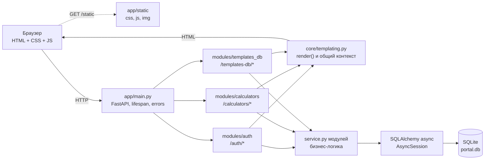
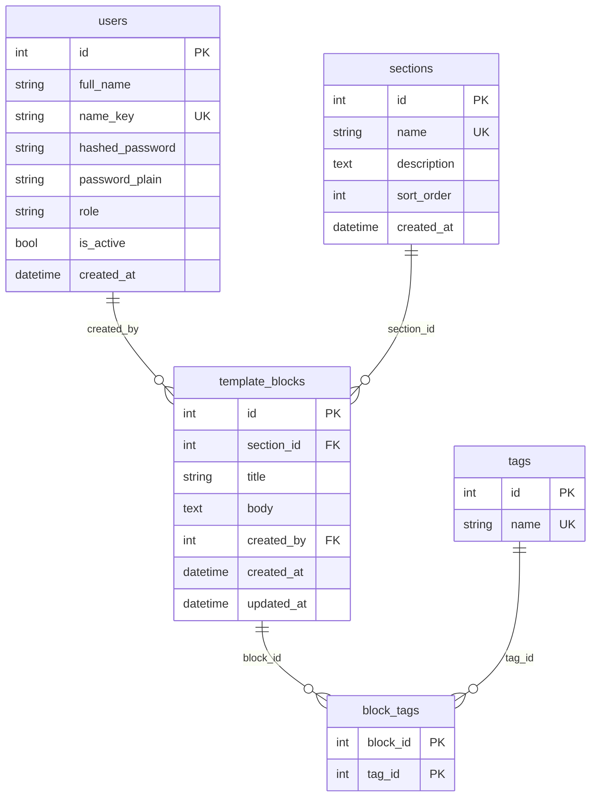

# Карта проекта

> Снимок на 17.10.2026, коммит `2d0ef83` (ветка `main`).
> Документ описывает фактическую структуру кода. Источник истины — код и
> `clinerules/`; при расхождении с `README.md` или `memory-bank/` ориентируйтесь
> на код.

## 1. Назначение и состав

Внутренний портал нотариальной конторы для локальной сети: серверный рендеринг
Jinja2, FastAPI и SQLite. Клиентского фреймворка и сборщика нет — интерактивность
обеспечивают обычные ES5-скрипты из `app/static/js/`.

| Параметр | Значение |
| --- | --- |
| Точка входа | `app/main.py` → `app.main:app` |
| Python | 3.11+ (в окружении 3.12) |
| Веб-сервер | Uvicorn, обычно `http://127.0.0.1:8000` |
| ORM | SQLAlchemy 2.0 async + `aiosqlite` |
| БД | SQLite `portal.db` в корне (в `.gitignore`) |
| Шаблоны | Jinja2, `app/templates/` |
| Статика | `app/static/`, монтируется на `/static` без кэширования |
| Авторизация | bcrypt + JWT HS256 в httpOnly-cookie `portal_token` |
| Функциональные модули | `auth`, `calculators`, `templates_db` |
| Клиентские скрипты | 8 файлов в `app/static/js/` |
| Jinja-шаблоны | 17 файлов в `app/templates/` (включая `base.html` и эталон `_block_template.html`) |

## 2. Слои и направление зависимостей



Ключевые правила:

- Роутеры подключаются только в `app/main.py`; префиксы задаются там же:
  `auth` — `/auth`, `calculators` — `/calculators`, `templates_db` —
  `/templates-db`.
- Все страницы рендерятся через `render()` из `app/core/templating.py`, который
  добавляет `user`, `initials`, `role_label`, `role_labels`, `active_menu`.
- Модели импортируются в `app/main.py` до `Base.metadata.create_all`, иначе
  SQLAlchemy не создаст их таблицы.
- `calculators` не имеет моделей и не пишет в БД: расчёты либо клиентские, либо
  выполняются чистой функцией в `service.py`.
- `templates_db` работает с БД через собственный `service.py`; его `models.py`
  не импортирует `auth.models`, а ссылается на таблицу `users` строкой.

## 3. Структура каталогов

```text
Portal/
├── app/
│   ├── main.py                  сборка FastAPI, статика, роутеры, /dashboard
│   ├── core/
│   │   ├── config.py            Settings из .env (pydantic-settings)
│   │   ├── database.py          async engine, sessionmaker, get_db()
│   │   ├── security.py          bcrypt, JWT, cookie portal_token
│   │   └── templating.py        render(), initials(), ROLE_LABELS, MENU_PANEL/USERS/PROFILE
│   ├── db/
│   │   └── base.py              единый DeclarativeBase
│   ├── modules/
│   │   ├── auth/                пользователи, вход, роли, профиль
│   │   ├── calculators/         каталог и страницы калькуляторов
│   │   └── templates_db/        база заготовок: разделы, теги, блоки
│   ├── templates/
│   │   ├── base.html            общий каркас, шапка, меню, блок scripts
│   │   ├── auth/                login.html, users.html, profile.html
│   │   ├── dashboard/           index.html
│   │   ├── calculators/         index + 6 страниц + _block_template.html
│   │   └── templates_db/        index, section_form, block_form, block_view
│   └── static/
│       ├── css/styles.css       рабочая копия дизайн-кода
│       ├── img/logo.jpg
│       ├── js/                  8 клиентских скриптов
│       └── _probe.html          диагностическая страница, не часть портала
├── clinerules/
│   ├── 01-carcass.md            стек, структура, запреты
│   └── 02-calculators.md        правила и эталоны калькуляторов
├── memory-bank/                 справочник состояния проекта
├── scripts/create_admin.py      создание администратора
├── styles.css                   утверждённый дизайн-код (корневая копия)
├── alembic.ini                  конфиг Alembic, миграции не используются
├── requirements.txt             зафиксированные зависимости
├── run.bat                      запуск: venv, зависимости, .env, админ, сервер
├── README.md                    вход, роли, запуск, переменные окружения
├── .env.example                 шаблон настроек
├── portal.db                    локальная SQLite (не в git)
├── uvicorn.log                  лог запуска (игнорируется)
└── uvicorn.err                  баннер запуска (отслеживается git)
```

`venv/`, `__pycache__/`, `.env`, `*.db` и `*.log` исключены через `.gitignore`.

## 4. Функциональные модули

### 4.1. `app/modules/auth` — вход и пользователи

| Файл | Назначение |
| --- | --- |
| `models.py` | модель `User` (таблица `users`) |
| `schemas.py` | `LoginForm`, `UserCreate`, `AdminUserUpdate`, `PasswordChange`, `name_key()` |
| `service.py` | поиск, создание, переименование, смена пароля, удаление, аутентификация |
| `dependencies.py` | `CurrentUser`, `OptionalUser`, `require_role()` |
| `routes.py` | `APIRouter(prefix="/auth")`: вход, выход, пользователи, профиль |

Модель `User`:

- `id` — первичный ключ;
- `full_name` — ФИО, оно же логин (только русские буквы, пробел и дефис);
- `name_key` — нормализованное имя без учёта регистра, уникально;
- `hashed_password` — bcrypt-хеш;
- `password_plain` — пароль в открытом виде для просмотра администратором;
- `role` — `admin` («Нотариус») или `user` («Сотрудник»);
- `is_active` — активность учётной записи;
- `created_at` — дата создания.

Механика доступа:

1. `POST /auth/login` проверяет имя и пароль через `authenticate_user()`.
2. При успехе `create_access_token(subject=str(user.id), role=user.role)`
   подписывает JWT HS256.
3. Токен кладётся в httpOnly-cookie `portal_token` (`SameSite=Lax`, срок
   `ACCESS_TOKEN_EXPIRE_MINUTES`, по умолчанию 480 минут).
4. `get_current_user()` декодирует токен, читает пользователя по `id` и
   проверяет `is_active`; в токене нет имени, поэтому переименование не рвёт
   сессию.
5. `require_role("admin")` ограничивает раздел «Пользователи».
6. Неавторизованный запрос (`401`) перенаправляется на `/auth/login`, запрос без
   прав (`403`) — на `/dashboard?denied=1`.

### 4.2. `app/modules/calculators` — калькуляторы

| Файл | Назначение |
| --- | --- |
| `routes.py` | каталог, страницы калькуляторов, серверный расчёт госпошлины |
| `schemas.py` | валидация госпошлины и справочники подписей `*_LABELS` |
| `service.py` | `CALCULATOR_BLOCKS`, тарифы, `calculate_gosposhlina()`, `format_money()` |

Моделей БД у модуля нет. Каталог карточек задаётся кортежем `CALCULATOR_BLOCKS`
в `service.py` (блоки разделены линиями на странице списка); чтобы добавить
калькулятор, нужно добавить карточку в нужный блок, роут, шаблон и (для
клиентского расчёта) JS-файл.

Страницы раздела:

| Калькулятор | Где считается | Ключевая логика |
| --- | --- | --- |
| Расчет и сдача | браузер | `raschet-i-sdacha.js`, пятнадцать сумм и поле «Итого» |
| Купля-продажа, обязательная форма | браузер | `calculators.js`, тариф 0,5 %, минимум 300 ₽, максимум 20 000 ₽ |
| Удостоверение ДКП, необязательная форма | браузер | `udostoverenie-dkp.js`, категории получателя |
| Удостоверение дарения недвижимости | браузер | `udostoverenie-dareniya.js`, категории получателя |
| Выделение долей по МСК | браузер | `vydelenie-doley-msk.js`, подбор доли, стоимость, нотариальный тариф и льгота |
| Госпошлина | сервер | `POST /calculators/gosposhlina` → `GosposhlinaInput` → `calculate_gosposhlina()` |

Клиентские калькуляторы:

- обновляют показатели при каждом `input`;
- перехватывают `submit` и не отправляют форму;
- хранят введённые значения в `localStorage`;
- форматируют суммы через `money-input.js`;
- не пишут данные на сервер.

Серверный калькулятор госпошлины:

- принимает форму с суммой, типом сделки и категорией плательщика;
- валидирует данные Pydantic-схемой;
- считает чистую функцию `calculate_gosposhlina()`;
- возвращает тот же шаблон с результатом или сообщением об ошибке.

### 4.3. `app/modules/templates_db` — база заготовок

| Файл | Назначение |
| --- | --- |
| `models.py` | `Section`, `Tag`, `TemplateBlock`, ассоциативная таблица `block_tags` |
| `schemas.py` | валидация разделов, заготовок, тегов, превью |
| `service.py` | CRUD, поиск, теги, преобразование ORM в схемы чтения |
| `routes.py` | `APIRouter(tags=["templates_db"])`: разделы, заготовки, поиск |

Модели:

- `Section` — раздел базы (`name` уникально, `description`, `sort_order`);
- `Tag` — тег в нижнем регистре (`name` уникально);
- `TemplateBlock` — заготовка (`section_id`, `title`, `body`, `created_by`,
  `created_at`, `updated_at`);
- `block_tags` — связь многие ко многим между заготовками и тегами с
  каскадным удалением связей.

Особенности:

- автор хранится как `users.id`; `models.py` не импортирует `auth.models`
  (в роутах `User` используется только для аннотаций);
- связь автора загружается жадно (`lazy="joined"`), потому что ленивая
  загрузка в async-сессии запрещена;
- новые теги создаются автоматически при сохранении заготовки;
- удалить непустой раздел нельзя — `SectionNotEmptyError`;
- после успешных действий выполняется `303 RedirectResponse` с флагом
  `?saved=1`, `?created=1`, `?updated=1` или `?deleted=1`.

## 5. Маршруты

Обозначения доступа: **все** — без авторизации, **авторизован** — любой активный
сотрудник, **admin** — только роль `admin`.

### 5.1. Корень и панель (`app/main.py`)

| Метод | Путь | Доступ | Обработчик | Результат |
| --- | --- | --- | --- | --- |
| GET | `/` | все | `root` | `303` на `/dashboard` |
| GET | `/dashboard` | авторизован | `dashboard` | `dashboard/index.html`; `?denied=1` — пояснение об отказе |

Обработчики ошибок: `401` → `/auth/login`, `403` → `/dashboard?denied=1`.

### 5.2. Аутентификация (`app/modules/auth/routes.py`)

| Метод | Путь | Доступ | Обработчик | Результат |
| --- | --- | --- | --- | --- |
| GET | `/auth/login` | все | `login_form` | `auth/login.html`; уже вошедшего ведёт на `/dashboard` |
| POST | `/auth/login` | все | `login` | проверка пароля, cookie `portal_token`, `303` на `/dashboard` |
| POST | `/auth/logout` | авторизован | `logout` | удаление cookie, `303` на `/auth/login` |
| GET | `/auth/users` | admin | `users_page` | `auth/users.html`; `?edit=<id>` — форма правки |
| POST | `/auth/register` | admin | `register` | создание сотрудника, `303` на `/auth/users?created=1` |
| POST | `/auth/users/{user_id}/update` | admin | `users_update` | смена имени и пароля, `303` на `?updated=1` |
| POST | `/auth/users/{user_id}/delete` | admin | `users_delete` | удаление, кроме себя, `303` на `?deleted=1` |
| GET | `/auth/profile` | авторизован | `profile_page` | `auth/profile.html` |
| POST | `/auth/profile/password` | авторизован | `profile_password_change` | смена своего пароля, `303` на `?updated=1` |

### 5.3. Калькуляторы (`app/modules/calculators/routes.py`)

| Метод | Путь | Доступ | Обработчик | Шаблон / результат |
| --- | --- | --- | --- | --- |
| GET | `/calculators/` | авторизован | `index_page` | `calculators/index.html` |
| GET | `/calculators/raschet-i-sdacha` | авторизован | `raschet_i_sdacha_page` | `calculators/raschet_i_sdacha.html` |
| GET | `/calculators/kuplya-prodazha` | авторизован | `kuplya_prodazha_page` | `calculators/kuplya_prodazha.html` |
| GET | `/calculators/udostoverenie-dkp` | авторизован | `udostoverenie_dkp_page` | `calculators/udostoverenie_dkp.html` |
| GET | `/calculators/udostoverenie-dareniya` | авторизован | `udostoverenie_dareniya_page` | `calculators/udostoverenie_dareniya.html` |
| GET | `/calculators/vydelenie-doley-msk` | авторизован | `vydelenie_doley_msk_page` | `calculators/vydelenie_doley_msk.html` |
| GET | `/calculators/gosposhlina` | авторизован | `gosposhlina_page` | `calculators/gosposhlina.html` |
| POST | `/calculators/gosposhlina` | авторизован | `gosposhlina_calculate` | тот же шаблон с результатом или ошибкой (400) |

### 5.4. База заготовок (`app/modules/templates_db/routes.py`)

| Метод | Путь | Доступ | Обработчик | Шаблон / результат |
| --- | --- | --- | --- | --- |
| GET | `/templates-db/` | авторизован | `index_page` | `templates_db/index.html` |
| GET | `/templates-db/search` | авторизован | `search_page` | `templates_db/index.html` с фильтрами `section_id`, `tag`, `q` |
| GET | `/templates-db/sections/new` | авторизован | `section_new_form` | `templates_db/section_form.html` |
| POST | `/templates-db/sections/new` | авторизован | `section_new` | создание раздела, `303` на `?saved=1` |
| GET | `/templates-db/sections/{section_id}/edit` | авторизован | `section_edit_form` | `templates_db/section_form.html` |
| POST | `/templates-db/sections/{section_id}/edit` | авторизован | `section_edit` | сохранение, `303` на `?saved=1` |
| POST | `/templates-db/sections/{section_id}/delete` | авторизован | `section_delete` | удаление пустого раздела, `303` на `?deleted=1` |
| GET | `/templates-db/blocks/new` | авторизован | `block_new_form` | `templates_db/block_form.html`; нужен хотя бы один раздел |
| POST | `/templates-db/blocks/new` | авторизован | `block_new` | создание заготовки, `303` на `?saved=1` |
| GET | `/templates-db/blocks/{block_id}` | авторизован | `block_view` | `templates_db/block_view.html` |
| GET | `/templates-db/blocks/{block_id}/edit` | авторизован | `block_edit_form` | `templates_db/block_form.html` |
| POST | `/templates-db/blocks/{block_id}/edit` | авторизован | `block_edit` | сохранение, `303` на `?saved=1` |
| POST | `/templates-db/blocks/{block_id}/delete` | авторизован | `block_delete` | удаление, `303` на `?deleted=1` |

## 6. Связка «шаблон → JavaScript»

`base.html` подключает `app.js` на всех страницах. Остальные скрипты
подключаются в `` конкретной страницы.

| Шаблон | Скрипты |
| --- | --- |
| `base.html` | `app.js` (заготовка, логики пока нет) |
| `auth/login.html`, `auth/users.html`, `auth/profile.html` | нет |
| `dashboard/index.html` | нет |
| `calculators/index.html` | нет |
| `calculators/raschet_i_sdacha.html` | `money-input.js`, `raschet-i-sdacha.js` |
| `calculators/kuplya_prodazha.html` | `money-input.js`, `calculators.js` |
| `calculators/udostoverenie_dkp.html` | `money-input.js`, `udostoverenie-dkp.js` |
| `calculators/udostoverenie_dareniya.html` | `money-input.js`, `udostoverenie-dareniya.js` |
| `calculators/vydelenie_doley_msk.html` | `money-input.js`, `vydelenie-doley-msk.js` |
| `calculators/gosposhlina.html` | `money-input.js`; расчёт на сервере |
| `calculators/_block_template.html` | `money-input.js`, `js/<slug>.js` — эталон, роутом не используется |
| `templates_db/index.html` | `templates_db.js` |
| `templates_db/section_form.html` | `templates_db.js` |
| `templates_db/block_form.html` | `templates_db.js` |
| `templates_db/block_view.html` | `templates_db.js` |

Назначение клиентских файлов:

| Файл | Ответственность |
| --- | --- |
| `money-input.js` | форматирование сумм в полях `[data-money]` неразрывными пробелами |
| `raschet-i-sdacha.js` | сумма пятнадцати полей в «Итого», Enter — к следующему полю |
| `calculators.js` | тариф за удостоверение договора купли-продажи (обязательная форма) |
| `udostoverenie-dkp.js` | тариф за удостоверение ДКП (необязательная форма) |
| `udostoverenie-dareniya.js` | тариф за удостоверение договора дарения |
| `vydelenie-doley-msk.js` | подбор долей по МСК, стоимость доли и нотариальный тариф |
| `templates_db.js` | копирование текста, поиск по Tab, подтверждение удаления |
| `app.js` | зарезервирован под общую логику портала |

Скрипты калькуляторов используют IIFE, `"use strict"`, ES5-совместимый
синтаксис и `localStorage`. Ключи хранения имеют префикс `calculators.*`,
поэтому данные разных калькуляторов не пересекаются.

## 7. Модель данных



Ограничения и поведение:

- `users.name_key` уникален: регистр и повторные пробелы не создают дублей.
- `sections.name` уникально; `sort_order` задаёт порядок разделов.
- `template_blocks.section_id` обязателен, `created_by` может быть пустым.
- `block_tags` — составной первичный ключ, при удалении блока или тега связи
  удаляются каскадно.
- `SectionNotEmptyError` не даёт удалить раздел, в котором есть заготовки.
- Схему создаёт `Base.metadata.create_all` при старте; Alembic-миграции не
  используются. Для существующей SQLite-базы колонки добавляются вручную.

## 8. Основные сценарии

### 8.1. Вход сотрудника

```text
GET /auth/login
  → login_form()
  → auth/login.html

POST /auth/login (full_name, password)
  → LoginForm (Pydantic)
  → authenticate_user() → bcrypt
  → create_access_token(subject=user.id, role=user.role)
  → Set-Cookie: portal_token (httpOnly, SameSite=Lax)
  → 303 /dashboard

Любой защищённый запрос
  → get_current_user()
  → decode_access_token() → get_user_by_id() → is_active
  → CurrentUser или 401
```

### 8.2. Клиентский расчёт калькулятора

```text
GET /calculators/<slug>
  → роут рендерит шаблон
  → base.html + money-input.js + <slug>.js
  → восстановление полей из localStorage
  → input → пересчёт → обновление .calc__out
  → «Очистить» → удаление ключей (кроме сохраняемых полей)
```

Сервер в расчёте не участвует, форма не отправляется. Ошибки ввода показываются
рядом с полем, пустые значения дают `0`, а не `NaN`.

### 8.3. Серверный расчёт госпошлины

```text
POST /calculators/gosposhlina
  → Form(amount, deal_type, payer_type)
  → GosposhlinaInput (валидация)
  → calculate_gosposhlina()
  → TARIFFS[(deal_type, payer_type)]
  → тот же шаблон с result / error
```

При ошибке валидации возвращается `400` и та же страница с текстом ошибки.

### 8.4. Работа с базой заготовок

```text
GET /templates-db/?section_id=&saved=&deleted=
  → list_sections() + list_blocks()
  → templates_db/index.html

POST /templates-db/blocks/new
  → TemplateBlockCreate (поля и теги)
  → create_block(..., created_by=user.id)
  → _get_or_create_tags()
  → 303 /templates-db/?saved=1
```

Поиск `GET /templates-db/search` фильтрует по разделу, тегу и подстроке в
заголовке/тексте. Просмотр блока — отдельная страница с кнопкой копирования.

### 8.5. Рендеринг страницы

```text
роут → render(request, "module/page.html", user=..., active_menu=...)
  → core/templating.py добавляет user, initials, role_label, role_labels,
    active_menu
  → Jinja2: base.html +  + 
  → HTMLResponse
```

`active_menu` управляет подсветкой пункта меню: `templates_db`, `calculators`,
`users`, `profile`, `panel`.

## 9. Где что менять

### Новый калькулятор

1. Добавить карточку в `CALCULATOR_BLOCKS` (`app/modules/calculators/service.py`)
   — в тот блок, где калькулятор должен стоять на странице списка.
2. Добавить `GET`-роут в `app/modules/calculators/routes.py`.
3. Создать шаблон в `app/templates/calculators/`.
4. Для клиентского расчёта создать `app/static/js/<slug>.js` и подключить его
   в `` вместе с `money-input.js`.
5. Для выпадающих списков добавить справочник `*_LABELS` в
   `app/modules/calculators/schemas.py` и передать его из роута.
6. Для серверного расчёта добавить схему ввода, функцию в `service.py` и
   `POST`-обработчик.
7. Проверить страницу и обновить эту карту и `memory-bank/`.

### Новый модуль

1. Создать `app/modules/<модуль>/` с `models.py`, `schemas.py`, `service.py`,
   `routes.py` (при необходимости `dependencies.py`).
2. Импортировать модели в `app/main.py` до `Base.metadata.create_all`
   (`# noqa: F401`).
3. Подключить роутер в `app/main.py` с нужным префиксом.
4. Добавить шаблоны в `app/templates/<модуль>/`.
5. При необходимости добавить пункт меню в `app/templates/base.html` и
   константу `MENU_*` в `core/templating.py` или роутере модуля.
6. Не добавлять новые зависимости без изменения правил проекта.

### Новая страница или пункт меню

- Страница: роут → `render()` → шаблон, наследующий `base.html`.
- Меню: форма/ссылка в `base.html` + сравнение `active_menu`.
- Доступ: `CurrentUser` для сотрудников, `AdminUser`/`require_role("admin")`
  для административных разделов.

### Стили

- Утверждённый дизайн-код — `styles.css` в корне.
- Рабочая копия, которую отдают шаблоны, — `app/static/css/styles.css`.
- Правила требуют править только рабочую копию; фактическая синхронизация
  `.calc__out` затронула обе копии (открытый вопрос в `memory-bank/`).
- Новые классы — БЭМ-подобные, токены цветов и шрифтов уже заданы в `:root`.

### Изменение схемы БД

- Таблицы создаются автоматически только при первом запуске; `create_all` не
  добавляет колонки в существующую таблицу.
- Для локальной SQLite колонку добавляют вручную через `ALTER TABLE`.
- Alembic установлен, но миграции не ведутся.
- После изменения модели обновить `schemas.py`, `service.py`, формы и шаблоны.

## 10. Запуск и проверка

### Запуск

```powershell
run.bat
# или
venv\Scripts\Activate.ps1
uvicorn app.main:app --host 0.0.0.0 --port 8000
```

Портал: <http://127.0.0.1:8000/auth/login>.

Первый администратор:

```powershell
python scripts/create_admin.py
python scripts/create_admin.py --name "Иванов Иван Иванович" --password "..."
```

### Проверки

Автотестов и `tests/` в проекте нет. Рабочие приёмы:

| Что проверяется | Команда / способ |
| --- | --- |
| Синтаксис JS | `node --check app/static/js/<файл>.js` |
| Синтаксис Python | `python -m py_compile <файл>` |
| Пробелы в diff | `git diff --check` |
| HTTP и наличие элементов | одноразовый Python-скрипт с cookie `portal_token` |
| Клиентский расчёт | Node + DOM-заглушка, загрузка реального JS |
| Вёрстка | headless Chrome, сравнение `getBoundingClientRect()` |
| Статика | `GET /static/...` → `200`, актуальное содержимое |

Для HTTP-проверок сервер должен быть запущен. Одноразовые скрипты и скриншоты
держат вне репозитория (например, в `%TEMP%`).

## 11. Технический долг и особенности

- **Нет автотестов**: проверки выполняются одноразовыми скриптами.
- **Alembic не используется**: `alembic.ini` есть, миграций нет; схема
  создаётся через `create_all`.
- **Диагностические файлы в git**: `app/static/_probe.html` и `uvicorn.err`
  попали в репозиторий и не относятся к порталу.
- **Две копии стилей**: корневой `styles.css` и
  `app/static/css/styles.css`; нужно следить за расхождениями.
- **Устаревшие части README**: структура и некоторые примечания отстают от
  кода; источник истины — код и `clinerules/`.
- **Пароль в открытом виде**: `password_plain` хранится намеренно, чтобы
  администратор мог выдать сотруднику пароль; это осознанный компромисс.
- **Дублирование справочников**: ключи `*_LABELS` в Python должны совпадать с
  ключами в JS-калькуляторах.
- **Клиентский расчёт не сохраняется на сервере**: данные живут только в
  `localStorage` браузера.
- **SQLite**: один локальный файл `portal.db`, резервная копия делается
  копированием файла при остановленном сервере.

## 12. Поддержание карты

Карту нужно обновлять при:

- добавлении или удалении модуля, роута, шаблона или JS-файла;
- изменении модели данных или схемы БД;
- изменении способа расчёта калькулятора;
- изменении меню, ролей или правил доступа;
- изменении команд запуска и проверки.

При расхождении карты и кода приоритет у кода. После правок проверяйте ссылки,
Mermaid-блоки и таблицы, затем выполняйте `git diff --check`.
